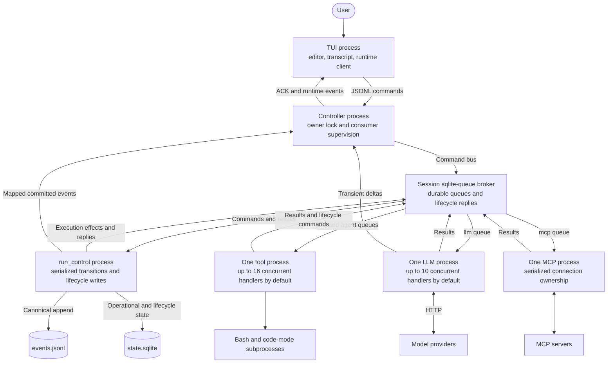
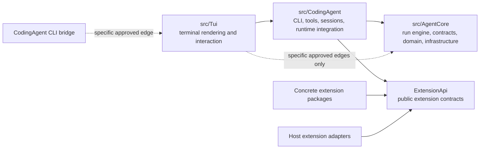

# Hatfield architecture

The default interactive path crosses process boundaries. Commands go in, workers
execute effects, and runtime events return to the terminal. The response does not
return through one synchronous call stack.

View these repository-only diagrams in a Markdown renderer with Mermaid support.
This overview and [processes and queues](processes-and-queues.md) describe the
shared Fiber workers. Older lifecycle diagrams describe logical roles, not one
process per queue; historical audits state their own source revision.

## Diagram map

| Question | Diagrams |
|---|---|
| How does a prompt become an answer? | [Request lifecycle](request-lifecycle.md): end-to-end sequence, input routing, tool loop, live projection |
| How do processes and Fibers share work? | [Processes and queues](processes-and-queues.md): topology, admission, state isolation, metadata ownership, shutdown |
| Who owns state and how does recovery work? | [State and recovery](state-and-recovery.md): commit order, storage, replay, repair, compaction, cancellation |
| Which database queries need refresh? | [Database query decisions](orm-freshness-map.md): methods, reads/writes, refresh decisions, and reasons |
| How do tool calls, approvals, and MCP work? | [Tools and MCP](tools-and-mcp.md): registration, execution, human continuations, connection lifecycle |
| How do extensions and child agents run? | [Extensions and agents](extensions-and-agents.md): loading, child supervision, jobs, background commands |
| How does bash become background work? | [Backgrounding](backgrounding.md): user decision, process ownership, completion notification, stop, cleanup |
| What reaches the model and the screen? | [Context and projection](context-and-projection.md): prompt composition, provider request, streaming, TUI sessions |
| What goes into a release? | [Build and observability](build-and-observability.md): packaging, QA lanes, logging |
| Where do logs, traces, and metrics go? | [Logging](logging.md): record enrichment, Fiber scopes, rotation, Datadog ingestion, privacy, sink failures |

## Discovery proposals

[PHP code mode](php-code-mode-discovery.md) is a superseded discovery note. The
implemented direct `code_mode` tool is documented in
[tools.md](../docs/tools.md).

## Process topology

This map keeps only process boundaries. The linked sequences expand handlers and
messages within each boundary. Parent and child runs have separate identities but
share the controller's workers. LLM calls overlap in one PHP process; generic
tools and child launch/resume calls overlap in another. Each uses cooperative
Fibers, not one PHP process per invocation.

The queue arrows summarize delivery. They are not direct calls between worker
processes. The broker and its SQLite helper remain separate from execution workers.
The `agent` queue still exists, but has no separate consumer process. Scheduler and
optional extension-agent workers are detailed in [processes and queues](processes-and-queues.md).

`runtime.llm_concurrency` bounds active LLM handlers, not process counts.
`runtime.tool_concurrency` still exists for the shared tool consumer. A waiting
handler yields so another Fiber can run; synchronous CPU or blocking I/O still
blocks its process. `tools.execution.max_parallelism` separately limits admission
within a tool batch.

Bash foreground work supervises natively and publishes one-way lifecycle events
to `run_control` through an ordinary result envelope stamp. Code-mode
registration and child launch-success are also one-way owner commands; generic
deferred registration still uses a reply RPC.
Tool context, log/trace scopes and run-lock reentrancy are isolated by
Fiber. See the
[persistence ownership flow](processes-and-queues.md#lifecycle-persistence-ownership)
for the current boundary.

## Code boundaries

[depfile.yaml](../depfile.yaml) and `castor deptrac` define exact edges. This is not
a blanket ban on every dependency omitted from the diagram. AgentCore does not
reference CodingAgent or TUI. ExtensionApi does not reference host internals.

## Event legend

| Channel | Sequence | Durable? | Use |
|---|---|---|---|
| Canonical `RunEvent` | Positive | `events.jsonl` | History, replay, committed lifecycle |
| Mapped runtime event | Preserves canonical identity where applicable | Delivery of committed data | TUI projection |
| Streaming delta | `0` | No | Live text, reasoning, tool arguments |
| Messenger envelope | Not an event sequence | Session sqlite-queue broker in controller mode | Commands, execution, results, delayed work |

Sources: [Messenger configuration](../config/packages/messenger.yaml),
[HeadlessController](../src/CodingAgent/Runtime/Controller/HeadlessController.php),
[RunCommit](../src/AgentCore/Application/Pipeline/RunCommit.php),
[session runtime internals](../docs/session-runtime-internals.md).

The [documentation audit inventory](documentation-audit.md) records the earlier
Markdown pass and explicitly marks unfinished instruction-audit work.
