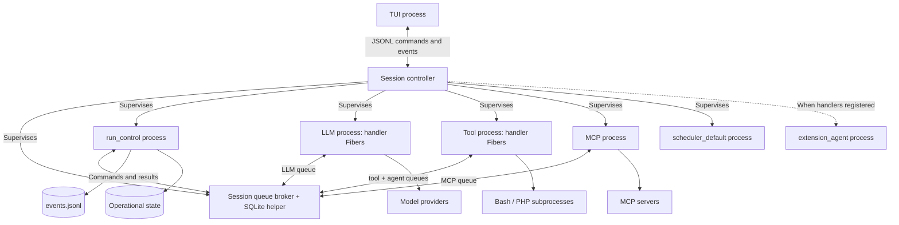
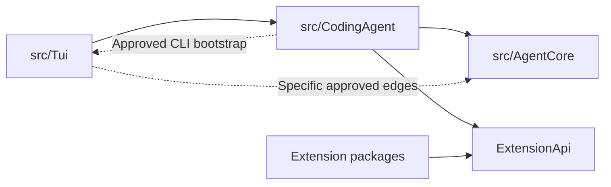

# Hatfield architecture

Hatfield runs a terminal client, a session controller, a session queue broker,
and execution consumers. Processes provide isolation; Amp Fibers overlap waiting
handlers **inside** the LLM and tool consumer processes.

## Read by question

| Question | Reference |
|---|---|
| Which processes own execution? | [Processes and queues](processes-and-queues.md), [runtime supervision](runtime.md) |
| How does a prompt become an answer? | [Request lifecycle](request-lifecycle.md) |
| What is durable, and what can recover? | [State and recovery](state-and-recovery.md), [session runtime](session-runtime.md) |
| How do PHP scripts and recurring work run? | [Code mode and scheduling](code-mode-and-scheduling.md) |
| How are tools, approvals and MCP routed? | [Tools and MCP](tools-and-mcp.md) |
| How do extensions and child agents run? | [Extensions and agents](extensions-and-agents.md), [agent communication](agent-communication.md) |
| Who owns background work? | [Backgrounding](backgrounding.md) |
| What reaches the model and screen? | [Context and projection](context-and-projection.md), [history conversion](history-conversion.md), [TUI](tui.md) |
| Where are fresh database reads required? | [ORM freshness](orm-freshness-map.md) |
| How are releases and diagnostics produced? | [Build](build-and-observability.md), [logging](logging.md) |

For configuration and daily use, start with [usage docs](../docs/README.md).
Architecture pages are repository references, not part of `hatfield_docs`.

## Process map

Parent and child runs share these consumers; a child does not get a new controller.
The scheduler generates recurring messages; it is not the durable deadline queue.
See [scheduling](code-mode-and-scheduling.md#scheduling) for its dispatch path.

## Code boundaries

[depfile.yaml](../depfile.yaml) and `castor deptrac` define the exact allowed
edges. AgentCore has no CodingAgent, TUI or concrete-extension dependency.
ExtensionApi exposes public contracts, not host implementation services.

## Event channels

| Channel | Authority |
|---|---|
| Canonical `RunEvent`, positive sequence | Append-only `events.jsonl`: history and replay |
| Mapped runtime event | Delivery/projection of committed events |
| Streaming delta, sequence `0` | Transient text, reasoning and tool arguments; never replay authority |
| Messenger envelope | Work delivery through queues, not conversation history |

A session's `session_id` equals its `run_id`. State transitions belong to
`run_control`; execution workers return results rather than mutating `RunState`.
