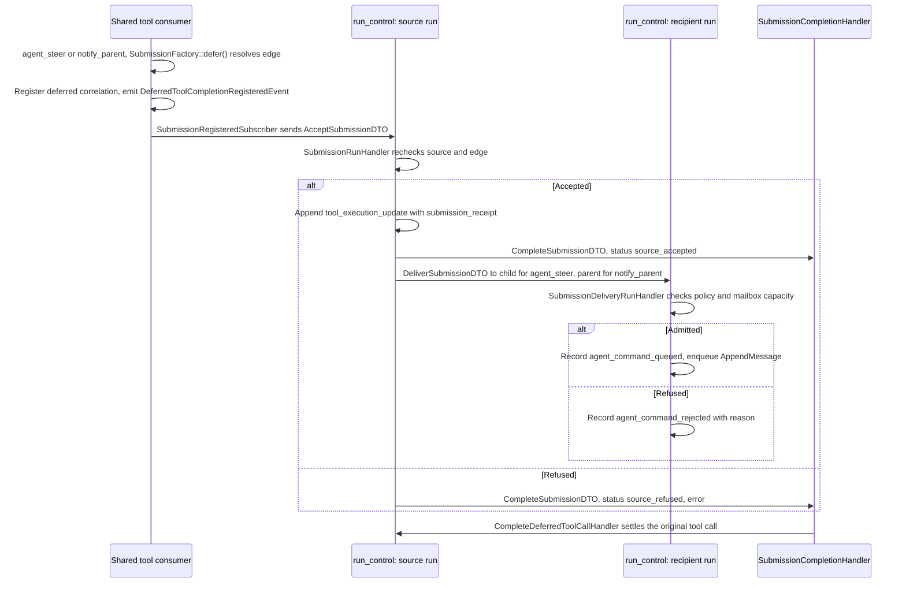

# Agent communication delivery

[Architecture](README.md) · [Child agents](extensions-and-agents.md) · [Tools](tools-and-mcp.md)

The `agent_steer` and `notify_parent` built-ins accept short authored text for a current direct parent-child edge and deliver it through the recipient's existing command mailbox. They use normal tool registration, argument mapping, validation, execution policy, and native deferred completion. There is no inbox API.

## Tool exposure

Each invokable tool implements `HatfieldToolProviderInterface` and maps a data-only argument DTO with Symfony AI. Steering requires exactly one existing child handle; notices expose only text and derive their destination. Both reject nested tool contexts before resolving a source submission. The code-mode bootstrap also rejects their names before host invocation.

The existing toolset resolver exposes steering to parents and notices to children whose canonical launch policy allows them. Explicit child allowlists and global exclusions still win. Child policy strips steering together with nested launch/resume tools; communication does not enable descendants. Inherit-all policies may inherit notices without modifying user-authored allowlists.

Communication runs on ordinary tool worker capacity. Registration releases the execution worker through the existing native deferred outcome, while owner acceptance produces the source-persistence receipt. No reserved messaging worker or preemption path exists.

## Submission flow

Source and recipient are different runs owned by the same session `run_control`
consumer. Every message below except the first execution routes to `run_control`.

## Identity and authorization

`SubmissionFactory::defer()` uses the native tool context and deferred child metadata to resolve the edge. Steering resolves a child handle within its parent registry. Notices derive the parent from the child's current deferred batch. Neither direction accepts a destination supplied in the message text.

The submission identity hashes the source run, turn, step and tool-call ID, the tool name, resolved parent and child, native batch lifecycle, and exact text. Artifact and run handles resolving to the same child produce the same identity. Rebinding a child for `agent_resume` changes its lifecycle and therefore changes the identity. Backgrounding does not change the identity.

Authorization checks the source's current canonical invocation, operational statuses, parent lifetime, native interruption and completion evidence, and the originating child call's retained ancestry. The disposable history index retains invocation locations after batch settlement so background notices can remain authorized across later parent turns. This lookup grants no execution permission and does not reconstruct a run.

Text must be nonblank, valid UTF-8, and at most 8,192 bytes. The input boundary uses Symfony Serializer and Validator. Text does not change approval, cancellation, deadline, or tool permissions.

## Owner acceptance

The execution worker registers the native deferred correlation before emitting `DeferredToolCompletionRegisteredEvent`. `SubmissionRegisteredSubscriber` submits `AcceptSubmissionDTO` to the source owner through `run_control`.

The owner enters normal transition recovery before handling acceptance. `SubmissionRunHandler` rechecks the source and resolves the current edge again. A changed lifecycle cannot match the frozen submission identity and receives a failed native tool completion instead of a receipt.

Acceptance appends a `tool_execution_update` containing `submission_receipt` to canonical `events.jsonl`. Its post-commit effects send `CompleteSubmissionDTO` (completing the original deferred tool call with `source_accepted`) and `DeliverSubmissionDTO` to the authenticated recipient. `SubmissionCompletionHandler` refuses a success completion without a canonical receipt. That result promises source persistence only, not receiver delivery or attention. Acceptance does not settle an unrelated foreground child call or change a human wait.

## Recovery and duplicate handling

The existing prepared append owns interrupted acceptance. No separate submission journal, queue, or scheduler exists. `SubmissionReceiptRepository` reads the accepted event through a disposable identity-to-sequence index and a bounded canonical event read. Deleting that index does not delete acceptance evidence; rebuilding it restores the same receipt.

A repeated source request returns the original receipt without another acceptance event or a new authorization decision. This remains true after the source advances or a child resumes. Failed transport sends retain the existing explicit-repair semantics; source acceptance is not a new automatic publication loop.

## Recipient admission and application

`SubmissionDeliveryRunHandler` resolves the canonical source receipt before accepting a recipient, and also rejects a message when the recipient's mailbox is at capacity. `SubmissionDeliveryPolicy` revalidates its direct edge, native lifecycle, parent lifetime, operational status, and retained originating invocation at admission and mailbox application. A later resume cannot inherit earlier steering. Cancelled, failed, interrupted, or discarded activities cannot authorize delivery.

Recipient admission records `agent_command_queued` or `agent_command_rejected` with the submission identity in canonical history. The same disposable location index preserves this decision after pending mailbox rows are deleted. Duplicate delivery cannot enqueue another message, including after index reconstruction.

Active recipients drain the mailbox at normal safe boundaries. Enqueueing does not interrupt an in-flight provider request or resolve a pending child tool call. Human waits and compaction defer application without changing their continuation. The generic consumption decision supports deferral; CodingAgent owns the policy.

A current background child's notice may request continuation of a normally completed root: admission then also dispatches an `AdvanceRun` coordination. Application rechecks this authority before the successor starts. A finished child cannot grant wake authority, but its already accepted foreground notice can still reach a running parent's next boundary. Steering never resumes a terminal child. No authored message revives a cancelled or failed owner.

Applied messages use the attributed `agent_communication` role with a provider-visible agent-authored wrapper. Runtime projection preserves that attribution in a non-human transcript block. Authored traffic does not enter the pending human-input display. Message text cannot choose routing or change approval and cancellation state.

Sources: [SubmissionFactory](../src/CodingAgent/Application/AgentCommunication/SubmissionFactory.php),
[SubmissionRegisteredSubscriber](../src/CodingAgent/Application/AgentCommunication/SubmissionRegisteredSubscriber.php),
[SubmissionRunHandler](../src/CodingAgent/Application/AgentCommunication/SubmissionRunHandler.php),
[SubmissionDeliveryRunHandler](../src/CodingAgent/Application/AgentCommunication/SubmissionDeliveryRunHandler.php),
[SubmissionDeliveryPolicy](../src/CodingAgent/Application/AgentCommunication/SubmissionDeliveryPolicy.php),
[SubmissionCompletionHandler](../src/CodingAgent/Application/AgentCommunication/SubmissionCompletionHandler.php),
[child tool policy](../src/CodingAgent/Agent/Execution/AgentToolPolicyResolver.php),
[Messenger routes](../config/packages/messenger.yaml).
