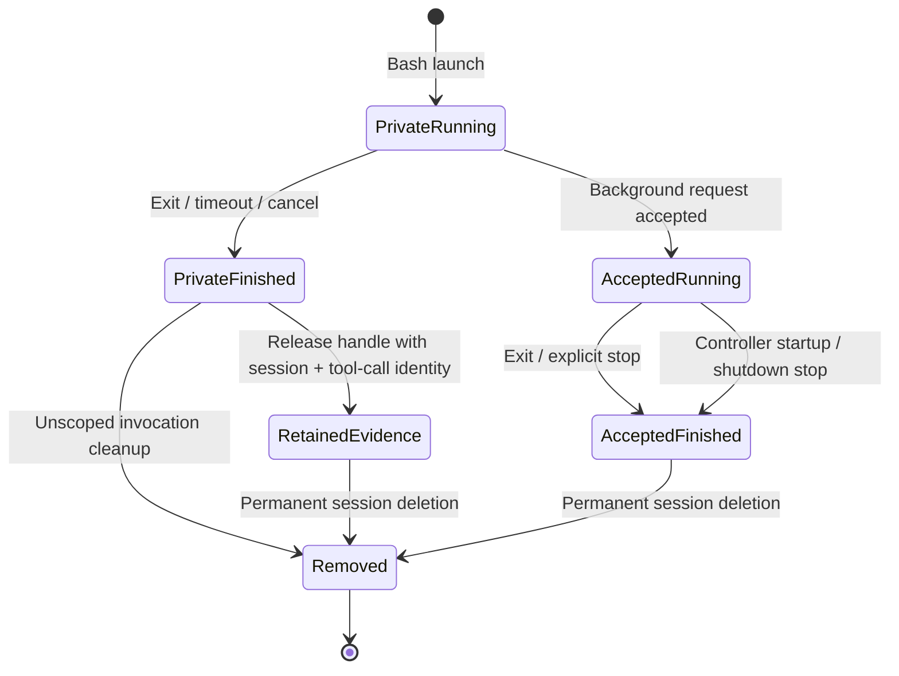
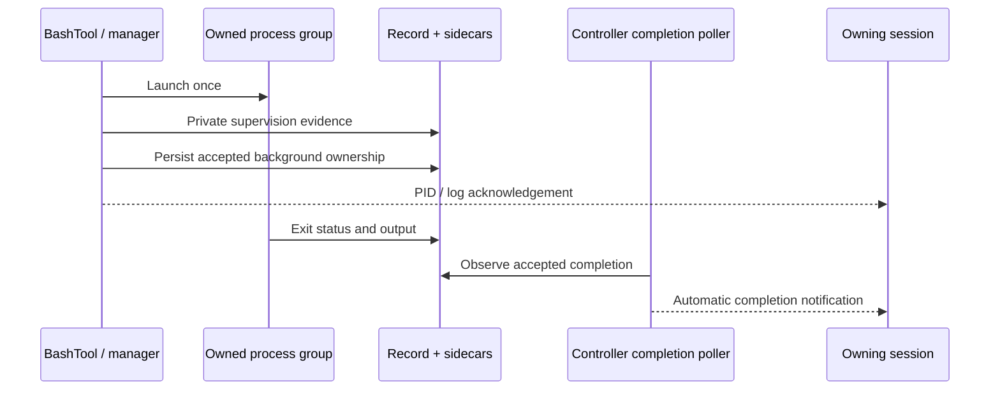

# Background execution ownership

[Architecture](README.md) · [Usage](../docs/background-processes.md) · [Code mode](code-mode-and-scheduling.md)

## Bash: one launch, ownership transfer

`BashTool` starts one supervised shell process group. Foreground supervision is
private; accepted background work is visible through `/bg` and `bg_status`.
The same record/process changes ownership—backgrounding never launches a copy.

A direct model call can set `backgrounded: true`; the user can request backgrounding
of an eligible foreground call with Ctrl+B. The manager validates the exact run,
record and tool-call identity and rechecks completion before acceptance. If the
process already finished, its ordinary foreground result wins. Acceptance persists
before returning the original call's acknowledgement; its deadline still applies.
There is no `bg_start` tool. Nested code-mode Bash cannot detach, and child/direct
shell eligibility follows the native supervision policy rather than PID alone.

`bg_status` resolves accepted Bash records for the current session. It cannot list
or stop private foreground supervision or arbitrary host PIDs. Stop validates owned
process-group evidence before TERM, then escalates after the configured grace if
still necessary. Missing/unverifiable evidence is not permission to signal.

## Cleanup owners

- Invocation cleanup releases the local native handle. When session and tool-call
  identity exist, foreground PID/status/log sidecars remain as replay evidence;
  release does not delete them or expose private work through `bg_status`.
  Unscoped launches instead delete their exact owned sidecars.
- Controller startup (after acquiring its owner lock) and shutdown clean recorded
  parent/child scopes by stopping owned groups. Scoped rows and native sidecars
  remain as replay evidence; permanent session deletion removes that evidence.
- Accepted Bash jobs can outlive a turn and worker recycling. They do not survive
  session-controller shutdown as a supported service.
- Code-mode scripts retain their original worker's IPC host. Backgrounded scripts
  still occupy a cooperative handler and fail when that host is lost.
- Background child calls use durable deferred supervision and later handoff
  delivery, not Bash process records. See [child agents](extensions-and-agents.md).

Cancel before Bash background acceptance stops foreground work; acceptance first
releases foreground ownership and preserves the accepted job. These checks do not
promise exactly-once signals or rollback. Never clean unrelated/root-owned
processes or manually signal active `HATFIELD_SESSION_ID` workers.

Sources: [BashTool](../src/CodingAgent/Tool/BashTool.php),
[BackgroundProcessManager](../src/CodingAgent/Tool/BackgroundProcessManager.php),
[completion poller](../src/CodingAgent/Runtime/Controller/BackgroundProcessCompletionPoller.php),
[lifecycle cleanup](../src/CodingAgent/Runtime/Controller/BackgroundProcessControllerSessionLifecycleListener.php).
