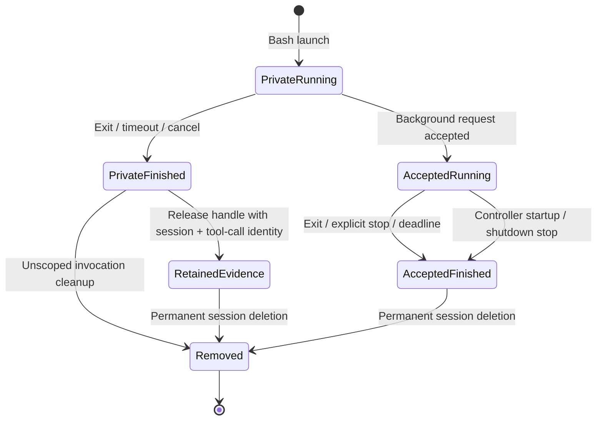
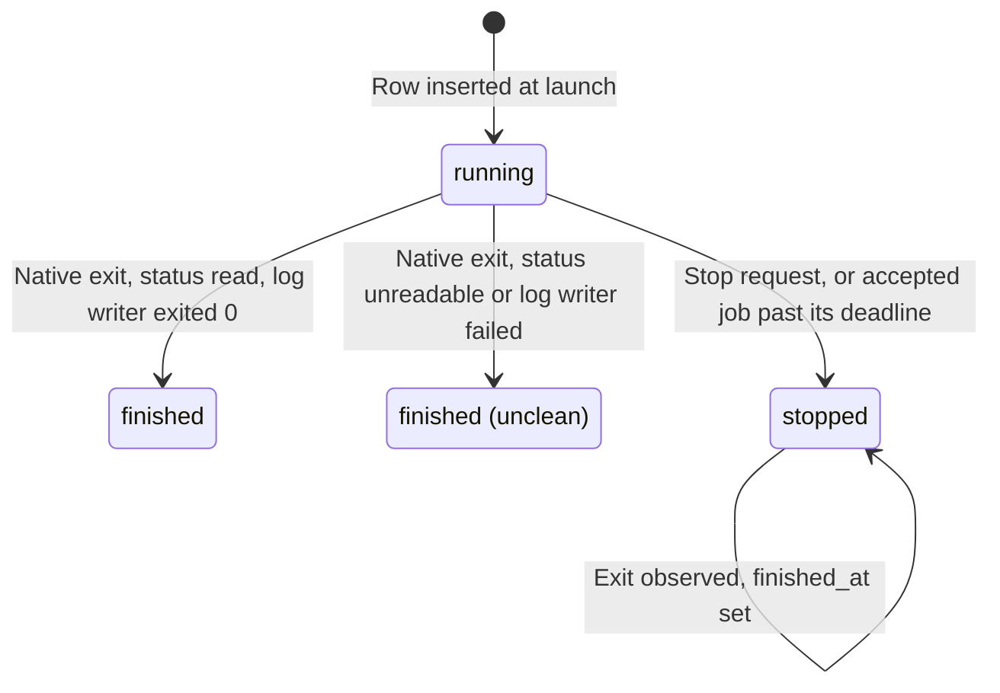
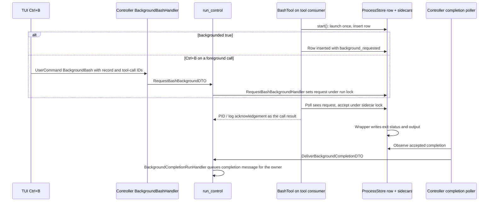

# Background execution ownership

[Architecture](README.md) · [Usage](../docs/background-processes.md) · [Code mode](code-mode-and-scheduling.md)

## Bash: one launch, ownership transfer

`BashTool` starts one supervised shell process group. Foreground supervision is
private; accepted background work is visible through `/bg` and `bg_status`.
The same record/process changes ownership—backgrounding never launches a copy.

Each record also carries a persisted `BackgroundProcessStatusEnum` value.
`ProcessStore` updates it as it observes the native process:

`stopped` without `finished_at` is shown as `stopping` by `bg_status`, and
`finished` with a non-zero exit code as `finished (exit code N)`; neither is a
stored value.

A direct model call can set `backgrounded: true`; the user can request backgrounding
of an eligible foreground call with Ctrl+B. Both set the record's background
request; the running `BashTool` loop then resolves and accepts it. The manager
validates the exact run, record and tool-call identity and rechecks completion and
cancellation before acceptance. If the process already finished, its ordinary
foreground result wins. Acceptance persists before returning the original call's
acknowledgement; the background deadline (explicit `timeout`, otherwise the
configured Bash maximum, if any) still applies. There is no `bg_start` tool. Nested code-mode Bash cannot
detach (`backgrounded: true` requires a top-level Bash invocation), and child/direct
shell eligibility follows the native supervision policy rather than PID alone.

If the controller rejects the request, or `RequestBashBackgroundHandler` finds the
call no longer eligible, the TUI receives a protocol error on the runtime event
stream instead of a second reply channel. A completion for a child run that has
already finished is forwarded to the root session's mailbox.

`bg_status` resolves accepted Bash records for the current session. It cannot list
or stop private foreground supervision or arbitrary host PIDs. Stop validates owned
process-group evidence before TERM, then escalates after the configured grace if
still necessary. Missing/unverifiable evidence is not permission to signal.

## Cleanup owners

- Invocation cleanup releases the local native handle. When session and tool-call
  identity exist, foreground PID/status/log sidecars remain as replay evidence;
  release does not delete them or expose private work through `bg_status`.
  Unscoped launches instead delete their exact owned sidecars.
- Controller startup (after acquiring its session owner lock) and shutdown clean
  recorded parent/child scopes by stopping owned groups
  (`BackgroundProcessControllerSessionLifecycleListener`). Scoped rows and native
  sidecars remain as replay evidence; permanent session deletion removes that
  evidence.
- Accepted Bash jobs can outlive a turn and worker recycling. They do not survive
  session-controller shutdown as a supported service.
- Code-mode scripts are separate native processes with their own catalog rows,
  independent of the worker that launched them; nested calls reach any shared tool
  slot over the session broker. Backgrounding a script changes its deferred
  metadata, not the process. `CodeModeProcessSessionLifecycleListener` fences and
  stops them at controller start and shutdown. See
  [code mode](code-mode-and-scheduling.md#background-and-launch-evidence).
- Background child calls use durable deferred supervision and later handoff
  delivery, not Bash process records. See [child agents](extensions-and-agents.md).

Cancel before Bash background acceptance stops foreground work; acceptance first
releases foreground ownership and preserves the accepted job. These checks do not
promise exactly-once signals or rollback. Never clean unrelated/root-owned
processes or manually signal active `HATFIELD_SESSION_ID` workers.

Sources: [BashTool](../src/CodingAgent/Tool/BashTool.php),
[BackgroundProcessManager](../src/CodingAgent/Tool/BackgroundProcessManager.php),
[ProcessStore](../src/CodingAgent/Tool/BackgroundProcess/ProcessStore.php),
[status enum](../src/CodingAgent/Entity/BackgroundProcessStatusEnum.php),
[background request handler](../src/CodingAgent/Application/BackgroundProcess/RequestBashBackgroundHandler.php),
[Ctrl+B listener](../src/Tui/Listener/BackgroundBashInputListener.php),
[completion poller](../src/CodingAgent/Runtime/Controller/BackgroundProcessCompletionPoller.php),
[completion delivery](../src/CodingAgent/Application/BackgroundCompletion/BackgroundCompletionRunHandler.php),
[lifecycle cleanup](../src/CodingAgent/Runtime/Controller/BackgroundProcessControllerSessionLifecycleListener.php).
