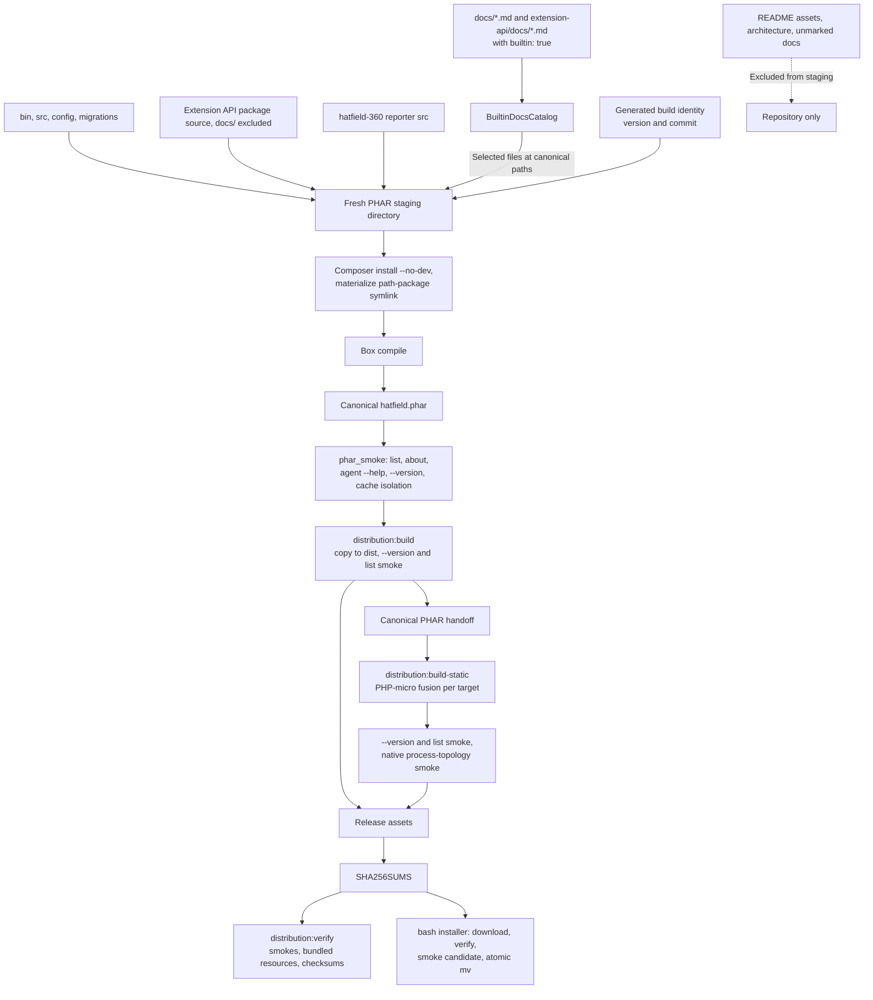
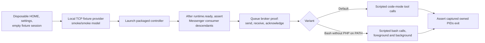
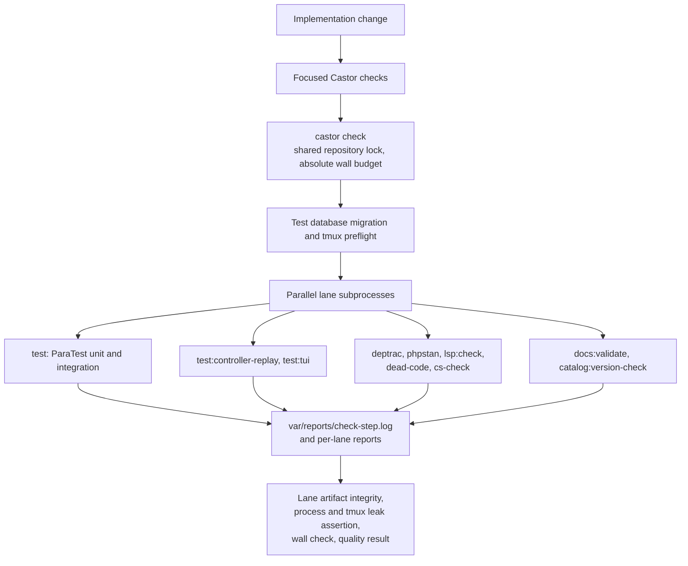
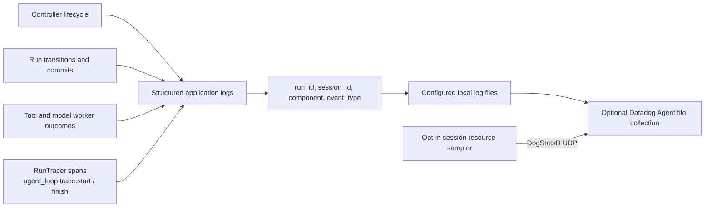

# Build and observability

[Architecture map](README.md) · [Logging](logging.md)

## One canonical PHAR, several release assets

`BuiltinDocsCatalog` has exactly two approved roots, top-level `docs/*.md` and
`.hatfield/extensions/extension-api/docs/*.md`; selection requires strict
`builtin: true` frontmatter and IDs must be unique across roots. The GIF and VHS
tape under `docs/assets/` are not catalog-selected Markdown. A failed compile or
PHAR smoke deletes the artifact, and only a successful smoke writes the freshness
marker.

Native builds reuse the canonical PHAR rather than rebuilding it or introducing a
second documentation catalog: release static jobs consume the PHAR job's artifact
as-is. `distribution:verify` additionally proves the PHAR contains bundled defaults,
themes, migrations and byte-identical selected docs, and rejects unmarked Markdown
under either docs root.

### Packaged process-topology smoke

`distribution_smoke_packaged_process_topology()` runs the default variant against the
PHAR during `distribution:verify`. Static binaries run both variants; the bash variant
restricts `PATH` so packaged Bash execution cannot fall back to a host PHP.
`distribution:verify --skip-topology` skips only the native runs.

## QA ownership

All lanes run without live model providers. The testing skill and `tests/AGENTS.md`
own exact prerequisites and budgets. Docs validation checks the selected catalog and
package-safe links; it is not proof that Mermaid diagrams render or that
architectural claims match source.

## Correlated logs, not transcript dumps

Do not log raw prompts, tool output, credentials, or entire sessions by default.
Operational logs help correlate a failure; `events.jsonl` remains conversation
history, not an observability export. Tracing is log-based; there is no APM
exporter. See [Logging](logging.md) for levels, fields and the sampler.

Sources: [castor check](../.castor/tasks.php), [PHAR compile](../.castor/helpers.php),
[distribution tasks](../.castor/distribution.php),
[docs catalog](../src/CodingAgent/Docs/BuiltinDocsCatalog.php),
[installer](../installer/bash-installer), [release workflow](../.github/workflows/release.yml),
[distribution](../docs/distribution.md), [PHAR packaging](../docs/phar-packaging.md),
[Datadog development setup](../docs/datadog.md), [testing procedure](../.agents/skills/testing/SKILL.md).
