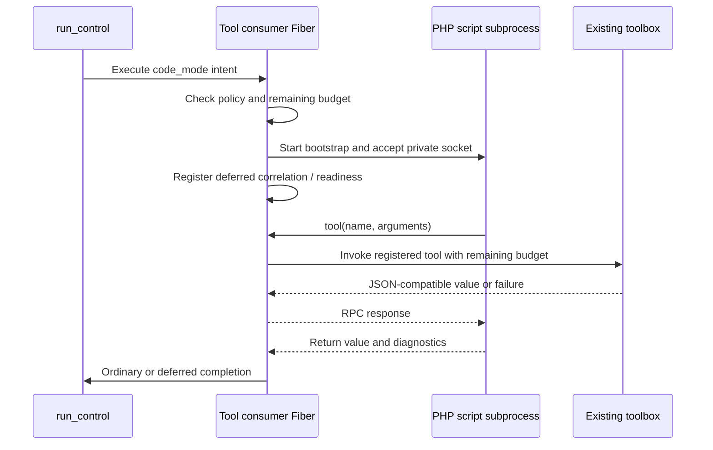
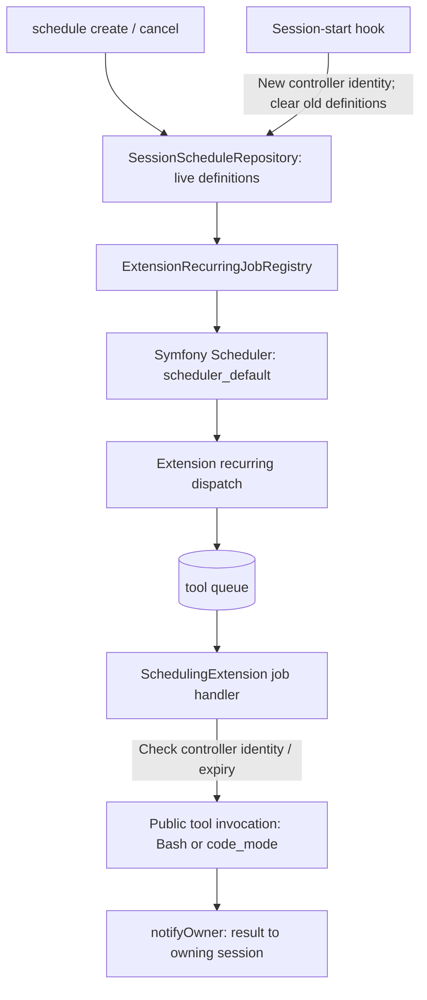

# Code mode and scheduling

[Architecture](README.md) · [Tool usage](../docs/tools.md) · [Recurring-work usage](../docs/background-processes.md)

## Code mode

`CodeModeTool` is an opt-in ordinary parallel tool, not a new worker role or an
LLM-generated-response adapter. `CodeModeHostBridge` launches an owned PHP CLI
subprocess with a minimal bootstrap. The script talks to the original tool worker
through private IPC; nested calls use the existing toolbox, hooks and approval
policy rather than a second tool implementation.

The script budget defaults to **1,800 seconds** (maximum **3,600**), memory to
**256 MiB** (maximum **1,024**). The parent remaining tool budget can shorten it.
Nested calls receive cooperative budget metadata; a synchronously blocking
handler can overrun until it returns. Scripts yield at host-side I/O, not by
turning arbitrary PHP filesystem/process calls into async toolbox calls.

Direct PHP bypasses hooks and approvals. Code mode inherits the launcher's
sandbox, if any; it creates none. Source/PHAR builds reuse their launching PHP
CLI; fused static builds need `php` on PATH. Deferred/interactive tools
(`subagent`, `fork`, `agent_resume`, `agent_steer`, `notify_parent`, `ask_human`)
are refused by the bridge.

Direct `backgrounded: true` calls use the existing deferred completion lifecycle.
The host keeps a worker Fiber and its private IPC connection until settlement;
worker loss interrupts the script, including backgrounded scripts. Readiness
prevents automatic replay but does not prove liveness or exactly-once startup.
`bg_status` controls Bash jobs, not PHP scripts. Script stdout/stderr capture is
bounded independently; oversized diagnostics use run-owned output artifacts.

## Scheduling

The optional built-in `SchedulingExtension` registers the main-only `schedule`
tool, `/schedule` picker, session-start hook, recurring source and extension-job
handler. It is disabled by default; no Composer package is needed.

Definitions are shared via a filesystem cache and lock, fenced by the current
controller identity. They are not a durable restoration contract: a new session
controller clears them. The first occurrence is immediately eligible; subsequent
occurrences use Symfony `RecurringMessage::every()` semantics. Optional lifetime
bounds future dispatch. Cancellation removes future occurrences, not an invocation
already running. Job execution checks that its definition still exists, belongs
to the same controller and has not expired.

Scheduled tool invocation is noninteractive: approval-required calls and human
questions are denied. A scheduled invocation cannot detach. Notifications use the
existing owner-message flow; no polling loop or extra coordinator is required.
Recurring occurrences explicitly redispatch to `tool`, reusing the extension-job
handler. Ordinary extension-agent dispatch instead uses `extension_agent`.

### Other clocks are separate

- File-completion index refresh is built-in recurring scheduler work, not a user
  `schedule` definition.
- Deferred child-batch deadlines use **durable `run_control` messages with
  `DelayStamp`**, not the in-memory recurring schedule.
- Code-mode and Bash timeouts belong to their invocation; recurring cancellation
  does not replace those execution deadlines.

Sources: [CodeModeHostBridge](../src/CodingAgent/Tool/CodeMode/CodeModeHostBridge.php),
[argument limits](../src/CodingAgent/Tool/Arguments/CodeModeArgumentsDTO.php),
[SchedulingExtension](../src/CodingAgent/Extension/Builtin/Scheduling/SchedulingExtension.php),
[schedule repository](../src/CodingAgent/Extension/Builtin/Scheduling/SessionScheduleRepository.php),
[recurring registry](../src/CodingAgent/Extension/ExtensionRecurringJobRegistry.php).
