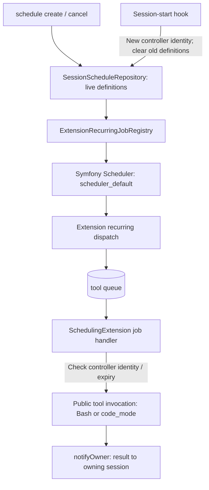

# Code mode and scheduling

[Architecture](README.md) · [Tool usage](../docs/tools.md) · [Recurring-work usage](../docs/background-processes.md)

## Code mode

`CodeModeTool` is an opt-in ordinary parallel tool, not a new worker role or an
LLM-generated-response adapter. `CodeModeHostBridge` launches an owned PHP CLI
subprocess. For canonical invocations in the session runtime, the shared tool
consumer launches PHP and returns a deferred outcome. `run_control` manages
state transitions; it does not execute scripts or nested tools.

```mermaid
sequenceDiagram
    participant Worker as Shared tool consumer
    participant PHP as Session-owned PHP subprocess
    participant Broker as SQLite-backed session broker
    participant Owner as Controller completion poller
    participant RC as run_control
    Worker->>PHP: Launch with invocation identity and controller settlement authority
    Worker->>Worker: Record ownership and commit admission before starting PHP
    Worker->>Worker: Return deferred outcome; release slot
    PHP->>Broker: Publish code_mode_requests with invocation and call IDs
    Broker->>Worker: Deliver request to available shared slot
    Worker->>Worker: Claim call, run existing toolbox, retain reply
    Worker->>Broker: Publish managed result reference to invocation reply queue
    Broker-->>PHP: Correlated reply with managed tool payload reference
    PHP->>Broker: Report return and wait for acknowledgement
    Broker->>Worker: Commit managed return reference before replying
    Owner->>RC: Publish deferred completion
```

The reply envelope carries a reference, not the result payload. Redelivery of a settled request can reuse
its retained result; an execution claim without a result is ambiguous and is
not replayed. These records do not restore a lost PHP stack or allow an
invocation to survive session shutdown. Owner notices use separate identities
from terminal completion.

The script budget defaults to **1,800 seconds** with no tool-specific cap, memory to
**256 MiB** (maximum **1,024**). The parent remaining tool budget can shorten it until background acceptance.
After acceptance only an explicit launch-relative timeout applies.
Nested calls observe the current script deadline through a live cancellation
token, not a snapshot in `ToolContext::timeoutSeconds()`. Detaching releases
the inherited limit even for a nested call already running; an explicit script
timeout still applies. A synchronously blocking handler can overrun until it returns. Scripts yield at host-side I/O, not by
turning arbitrary PHP filesystem/process calls into async toolbox calls.

Direct PHP bypasses hooks and approvals. Code mode inherits the launcher's
sandbox, if any; it creates none. Source/PHAR builds reuse their launching PHP
CLI; fused static builds need `php` on PATH. The launcher materializes a standalone
Composer runtime from the installed locked packages before starting external PHP.
The script process does not load the application kernel or open the state database.
Deferred/interactive tools
(`subagent`, `fork`, `agent_resume`, `agent_steer`, `notify_parent`, `ask_human`)
are refused by the bridge.

Direct `backgrounded: true` uses the existing deferred completion lifecycle.
Canonical launches reserve a row in the Doctrine background-process catalog and
run in separate native process groups with invocation-keyed PID and status
sidecars. The controller can stop the group and clean its workspace, including
when no PID was published. A reservation abandoned before native startup is
fenced and reported as an unknown launch, never replayed. PHP checks committed
admission at startup. `bg_status` controls Bash jobs, not PHP scripts.

Scripts can invoke ordinary tools but cannot recursively launch `code_mode`.
Calls without canonical correlation or a live session broker are refused.

Nested requests are claimed by a unique invocation/call key before tool execution. No database transaction spans the tool effect. The existing process-sidecar lock facility suppresses duplicate execution while a claimant is alive and releases on worker exit. A persisted claim without a reference yields a managed unknown-outcome error. Doctrine stores only reply references; both nested results and PHP returns live in the managed tool payload store. The worker publishes a managed tool result and sends its reference on the invocation reply queue. PHP waits for the matching call ID and reads the referenced result from the payload store.

## Scheduling

The optional built-in `SchedulingExtension` registers the main-only `schedule`
tool, `/schedule` picker, session-start hook, recurring source and extension-job
handler. It is disabled by default; no Composer package is needed.



Definitions are shared via a filesystem cache and lock, fenced by the current
controller identity. They are not a durable restoration contract: a new session
controller clears them. The first occurrence is immediately eligible; subsequent
occurrences use Symfony `RecurringMessage::every()` semantics. Optional lifetime
bounds future dispatch. Cancellation removes future occurrences, not an invocation
already running. Job execution checks that its definition still exists, belongs
to the same controller and has not expired.

Scheduled tool invocation is noninteractive: approval-required calls and human
questions are denied. A scheduled invocation cannot detach. Notifications use the
existing owner-message flow; no polling loop or extra coordinator is required.
Recurring occurrences explicitly redispatch to `tool`, reusing the extension-job
handler. Ordinary extension-agent dispatch instead uses `extension_agent`.

### Other clocks are separate

- File-completion index refresh is built-in recurring scheduler work, not a user
  `schedule` definition.
- Deferred child-batch deadlines use **durable `run_control` messages with
  `DelayStamp`**, not the in-memory recurring schedule.
- Code-mode and Bash timeouts belong to their invocation; recurring cancellation
  does not replace those execution deadlines.

Sources: [CodeModeHostBridge](../src/CodingAgent/Tool/CodeMode/CodeModeHostBridge.php),
[argument limits](../src/CodingAgent/Tool/Arguments/CodeModeArgumentsDTO.php),
[SchedulingExtension](../src/CodingAgent/Extension/Builtin/Scheduling/SchedulingExtension.php),
[schedule repository](../src/CodingAgent/Extension/Builtin/Scheduling/SessionScheduleRepository.php),
[recurring registry](../src/CodingAgent/Extension/ExtensionRecurringJobRegistry.php).
