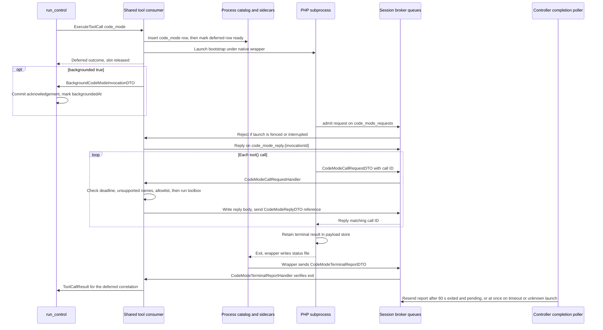
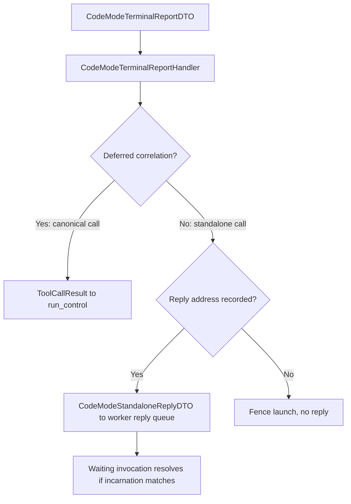
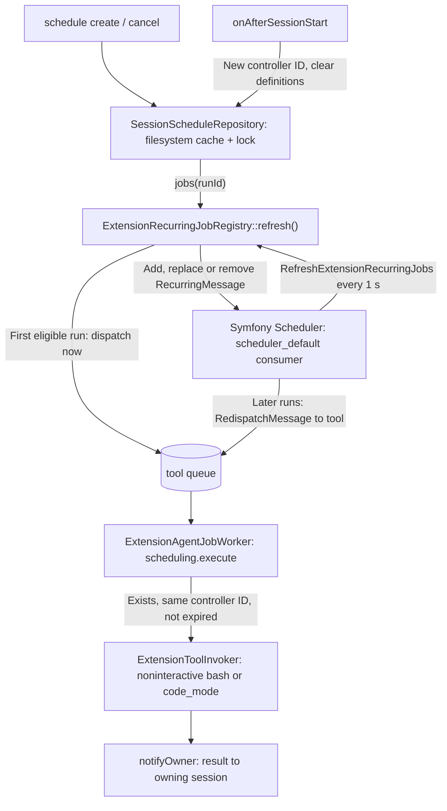

# Code mode and scheduling

[Architecture](README.md) · [Tool usage](../docs/tools.md) · [Recurring-work usage](../docs/background-processes.md)

## Code mode

`CodeModeTool` is an opt-in (`tools.code_mode.enabled`, default `false`) ordinary
parallel tool, not a new worker role or an LLM-generated-response adapter.
`CodeModeHostBridge` launches an owned PHP CLI subprocess. For canonical
invocations in the session runtime, the shared tool consumer launches PHP and
returns a deferred outcome. `run_control` manages state transitions; it does not
execute scripts or nested tools.

The shared tool consumer reads the `tool`, `agent` and `code_mode_requests`
transports. Script requests, the post-exit wakeup and controller recovery reports
all arrive on `code_mode_requests`; replies go to a per-invocation broker queue
`code_mode_reply.<invocationId>`.

The reply envelope carries a reference, not the result payload. Delivery may
repeat; individual tools own idempotency if needed. The worker does not persist
claims or replies in application state. The call ID correlates replies; it does
not suppress execution on redelivery. `notify_owner()` uses the same request queue
with a `notice` operation; the worker dispatches `DeliverBackgroundCompletionDTO`
to `run_control` under its own notice identity, separate from terminal completion.

Nested reply bodies belong to the script workspace. Each publication gets its own
body; PHP deletes a body after acknowledging its delivery. The process owner
removes remaining bodies once the script exits and refuses new bodies for a fenced
or retired workspace. Terminal reports and standalone terminal replies use separate
storage.

`CodeModeTerminalObserver` runs inside `BackgroundProcessCompletionPoller`. It
supervises native processes and may resend a terminal report after confirmed exit,
or immediately for a timeout, interruption or unknown launch outcome; it does not
process normal success. For canonical calls only the shared worker delivers
completion to `run_control`.

### Budgets

The script budget defaults to **1,800 seconds** with no tool-specific cap; memory
defaults to **256 MiB** (maximum **1,024**). Until background acceptance, the
parent's remaining tool budget can shorten the script budget. After acceptance
only an explicit `timeout_seconds` applies, measured from launch.

Nested calls run with `timeoutSeconds: null` and observe the current script
deadline through a live cancellation token (`CodeModeCancellationToken`).
Detaching releases the inherited limit even for a nested call already running; an
explicit script timeout still applies. A synchronously blocking handler can
overrun until it returns. Scripts yield at host-side I/O, not by turning arbitrary
PHP filesystem/process calls into async toolbox calls.

### Isolation and refused tools

Direct PHP bypasses hooks and approvals. Code mode inherits the launcher's
sandbox, if any; it creates none. Source/PHAR builds reuse their launching PHP
CLI; fused static builds need `php` on PATH. `CodeModeRuntimeMaterializer` copies
the locked dependency closure it needs (from `composer.lock` and `vendor/`) plus a
fixed set of host source files into the script workspace before starting PHP. The
script process does not load the application kernel or open the state database.

Nested calls are refused at two layers:

| Layer | Refused names |
|---|---|
| PHP bootstrap `tool()`, before any broker request | `subagent`, `fork`, `agent_resume`, `agent_cancel`, `agent_steer`, `notify_parent`, `ask_human` |
| Host `CodeModeCallRequestHandler` | `code_mode`, plus `CodeModeUnsupportedTools` (`subagent`, `fork`, `agent_resume`, `ask_human`) |

The host also rejects names outside the invocation's active allowlist and any
nested result that is a deferred outcome or human-input suspension.

### Background and launch evidence

Direct `backgrounded: true` uses the existing deferred completion lifecycle.
`CodeModeProcessOwner` reserves a `code_mode` row in the Doctrine
background-process catalog under the sidecar lock before launch, then runs PHP in
a separate native process group with invocation-keyed PID and status sidecars.
Controller start and shutdown (`CodeModeProcessSessionLifecycleListener`) fence
each launch, stop a live group and clean its workspace, including when no PID was
published. A reservation abandoned before native startup is fenced and reported as
an unknown launch, never replayed. PHP asks for admission at startup. `bg_status`
controls Bash jobs, not PHP scripts.

### Standalone calls

A live session broker is required. Standalone calls (for example a scheduled
`code_mode` through `ExtensionToolInvoker`) have no step ID and no agent-turn
batch; they must be foreground. `CodeModeStandaloneRepliesService` registers a
waiter on the worker's slot-addressed reply receiver, and
`CodeModeTerminalReportHandler` sends the processed result there as
`CodeModeStandaloneReplyDTO`. The waiter resolves only when the process
incarnation matches. The sequential `extension_agent` worker runs a scoped Symfony
Worker for that reply receiver only; it does not reserve another extension job.
Processes without a reply receiver, such as the controller itself, cannot run
standalone code mode.

## Scheduling

The optional built-in `SchedulingExtension` registers the main-only `schedule`
tool (`create`, `list`, `cancel`; target `bash` or `code_mode`), the `/schedule`
picker, a session-start hook, the `scheduling` recurring source and the
`scheduling.execute` extension-job handler. It is not in the default
`extensions.enabled` list; no Composer package is needed.

Definitions live in a filesystem cache under `.hatfield/cache`, written under a
Symfony lock and filtered by the current controller identity. They are not a
durable restoration contract: the session-start hook issues a new controller ID
and clears them.

The registry refreshes every second. A job enters the schedule only once it is
eligible; Symfony starts new triggers strictly after first observation, so the
registry dispatches the first execution itself with `TransportNamesStamp('tool')`.
Subsequent occurrences use `RecurringMessage::every()` semantics. Optional
lifetime (`for_seconds`) bounds future dispatch. Cancellation removes the
definition; the next refresh removes its trigger. It does not stop an invocation
already running. Job execution rechecks that its definition still exists, belongs
to the same controller and has not expired.

Scheduled tool invocation is noninteractive: the tool context disallows human
input, so approval-required calls are auto-denied and nothing can wait for a human
answer. A scheduled invocation cannot detach (`backgrounded: true` fails
validation). Notifications use the existing owner-message flow; no polling loop or
extra coordinator is required. Recurring occurrences explicitly redispatch to
`tool`, reusing the extension-job handler. Ordinary extension-agent dispatch
instead uses `extension_agent`.

### Other clocks are separate

- File-completion index refresh (`CompletionFileIndexRefreshCommand`, every 30
  seconds) and the session resource sampler are built-in tasks on the same
  `default` schedule, not user `schedule` definitions.
- Deferred child-batch deadlines use **durable `run_control` messages with
  `DelayStamp`**, not the in-memory recurring schedule.
- Code-mode and Bash timeouts belong to their invocation; recurring cancellation
  does not replace those execution deadlines.

Sources: [CodeModeHostBridge](../src/CodingAgent/Tool/CodeMode/CodeModeHostBridge.php),
[CodeModeCallRequestHandler](../src/CodingAgent/Tool/CodeMode/CodeModeCallRequestHandler.php),
[CodeModeTerminalReportHandler](../src/CodingAgent/Tool/CodeMode/CodeModeTerminalReportHandler.php),
[CodeModeProcessOwner](../src/CodingAgent/Tool/CodeMode/CodeModeProcessOwner.php),
[CodeModeTerminalObserver](../src/CodingAgent/Runtime/Controller/CodeModeTerminalObserver.php),
[standalone replies](../src/CodingAgent/Tool/CodeMode/CodeModeStandaloneRepliesService.php),
[PHP bootstrap](../src/CodingAgent/Tool/CodeMode/Resources/bootstrap.php.inc),
[argument limits](../src/CodingAgent/Tool/Arguments/CodeModeArgumentsDTO.php),
[SchedulingExtension](../src/CodingAgent/Extension/Builtin/Scheduling/SchedulingExtension.php),
[schedule repository](../src/CodingAgent/Extension/Builtin/Scheduling/SessionScheduleRepository.php),
[recurring registry](../src/CodingAgent/Extension/ExtensionRecurringJobRegistry.php),
[ExtensionToolInvoker](../src/CodingAgent/Extension/ExtensionToolInvoker.php).
