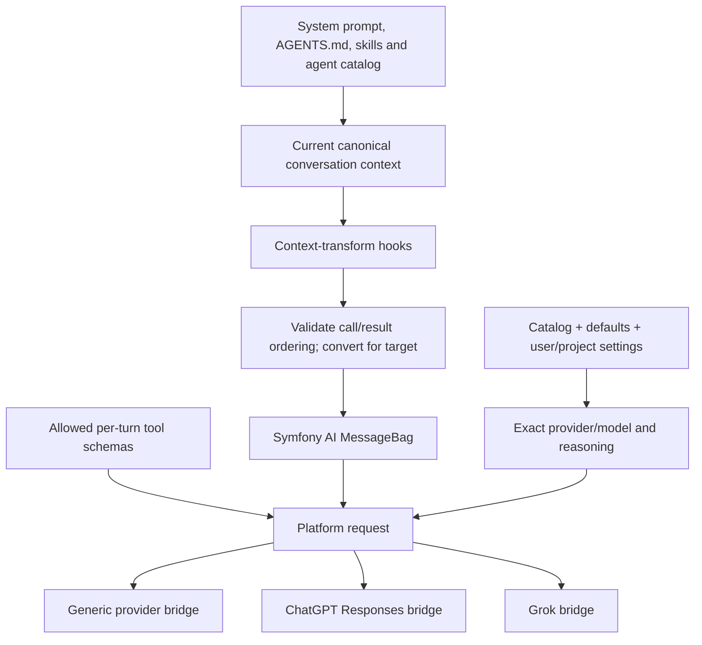
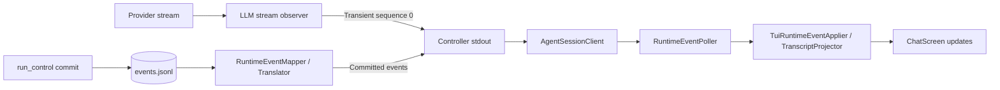

# Context and projection

[Architecture](README.md) · [Request lifecycle](request-lifecycle.md) · [TUI](tui.md)

## Provider request

Catalog metadata does not enable providers; setup is manual. Request-time
[history conversion](history-conversion.md) preserves canonical events while
adapting tool IDs and nonportable reasoning metadata for the target model.
Compaction changes model context separately from request conversion.

## Transient stream versus committed history

The mapper consumes `RunEvent`, not `RunState`. Canonical finalization completes
streamed blocks; `run.completed` clears activity without creating another answer.
Sequence-0 deltas never become a replay source.

Cold attach is owner-led: run control builds state and bounded transcript together,
then transfers sealed bootstrap frames. The TUI verifies and mounts them,
acknowledges the exact cut and applies the suffix through `session.ready`.
It does not read the event archive and construct a second execution state.

Active observers advance their canonical cursor only after successful application.
A failed poll can retry the same suffix; transient deltas remain separate. Child
live views rebuild on entry and release their projection on exit. Main transcript
retention follows successful compaction segments, not a fixed byte/row budget.

Sources: [LLM adapter](../src/AgentCore/Infrastructure/SymfonyAi/LlmPlatformAdapter.php),
[runtime mapper](../src/CodingAgent/Runtime/Protocol/RuntimeEventMapper.php),
[InteractiveMode](../src/Tui/Application/InteractiveMode.php),
[session runtime](session-runtime.md).
