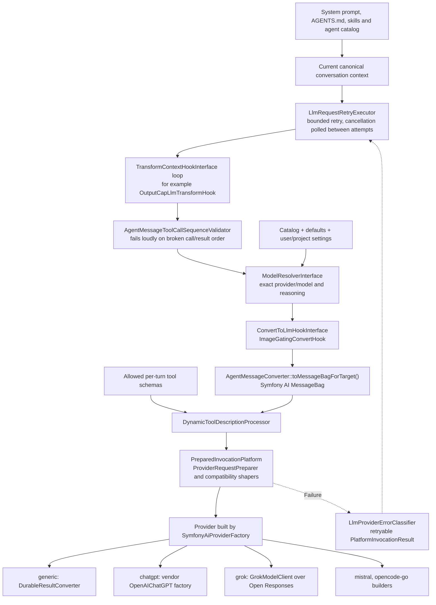
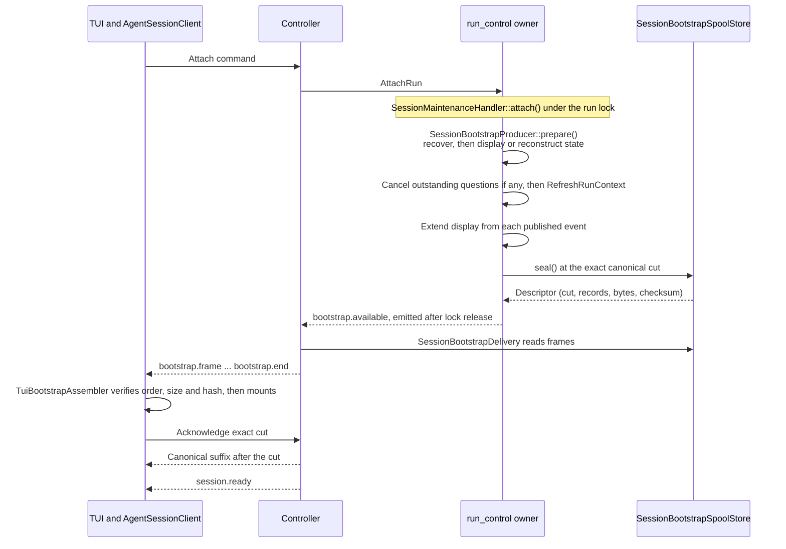

# Context and projection

[Architecture](README.md) · [Request lifecycle](request-lifecycle.md) · [TUI](tui.md)

## Provider request

Catalog metadata does not enable providers; setup is manual. Each retry attempt runs
the whole `invokeOnce()` path again. Request-time
[history conversion](history-conversion.md) preserves canonical events while adapting
tool IDs and nonportable reasoning metadata for the target model. Image gating
replaces `image_ref` parts with text placeholders when the resolved model lacks image
support. Compaction changes model context separately from request conversion.

`AgentMessageConverter` keeps a worker-local bag between requests;
`ConversionCacheIdleSubscriber` evicts it when an idle Messenger worker has not used
it for 60 seconds.

## Transient stream versus committed history

```mermaid
flowchart LR
    Provider["Provider stream"] --> Adapter["LlmPlatformAdapter::consumeStream()"]
    Adapter --> Observer["LlmStreamDispatchObserver"]
    Observer --> StreamSubs["AssistantTextStreamSubscriber,<br/>AssistantThinkingStreamSubscriber,<br/>ToolCallStreamSubscriber"]
    StreamSubs -->|"Transient seq 0"| ConsumerOut["Consumer stdout pipe<br/>or in-process sink"]
    Commit["run_control transition commit"] --> Log[(events.jsonl)]
    Commit --> Publish["StreamingCommittedRuntimeEventStore<br/>finalized hot batch"]
    Publish --> Mapper["RuntimeEventMapper / RuntimeEventTranslator"]
    Mapper -->|"Committed events"| ConsumerOut
    ConsumerOut --> Controller["ConsumerStdoutPoller<br/>controller stdout"]
    Controller --> Client["AgentSessionClient"]
    Client --> Poller["RuntimeEventPoller"]
    Poller --> Applier["TuiRuntimeEventApplier"]
    Applier --> Projector["TranscriptProjector facade"]
    Projector --> ProjSubs["ProjectionPipeline subscribers<br/>per event family"]
    ProjSubs --> Screen["ChatScreen updates"]
```

Stream subscribers listen for the exact delta class (`TextDelta`, `ThinkingDelta`,
tool-call deltas) plus `llm_stream.start` / `end` / `error`. They write to the
controller pipe only when stdout is a pipe; otherwise they use the in-process sink.

Committed events are mapped from the finalized in-memory batch after the canonical
append, not read back from `events.jsonl`. The mapper consumes `RunEvent`, not
`RunState`. `TranscriptProjector` wraps each runtime event in a
`TranscriptProjectionEvent` and dispatches it to family subscribers (assistant stream,
tools, HITL, compaction, run lifecycle, user messages and others) that mutate shared
`TranscriptProjectionState`. Canonical finalization completes streamed blocks;
`run.completed` clears activity without creating another answer. Sequence-0 deltas
never become a replay source.

## Cold attach

Cold attach is owner-led: run control builds state and transcript together and
transfers sealed bootstrap frames. The TUI does not read the event archive and
construct a second execution state, and the mounted projector is untouched until the
transfer validates. The spool is disposable and private (directory `0700`, file
`0600`); it enforces a 4 MiB transcript-view budget and an 8 MiB / 2001-record
transfer budget, and sealing fails rather than truncating.

## Retention

Active observers advance their canonical cursor only after successful application.
A failed poll keeps the unapplied suffix and retries it; transient deltas remain
separate. Child live views (`SubagentLiveChildViewPoller`) replay the child snapshot
on every entry and reset their projector on exit or switch. Main transcript retention
follows successful compaction segments (`TranscriptProjectionState` advances a
retention floor on `compaction.completed`), not a fixed byte/row budget; only the
cold-attach transfer above is byte-bounded.

Sources: [LLM adapter](../src/AgentCore/Infrastructure/SymfonyAi/LlmPlatformAdapter.php),
[image gating hook](../src/CodingAgent/Tool/ImageProcessing/ImageGatingConvertHook.php),
[converter idle eviction](../src/AgentCore/Infrastructure/SymfonyAi/ConversionCacheIdleSubscriber.php),
[provider factory](../src/CodingAgent/Infrastructure/SymfonyAi/SymfonyAiProviderFactory.php),
[stream observer](../src/CodingAgent/Runtime/Stream/LlmStreamDispatchObserver.php),
[committed publication](../src/CodingAgent/Runtime/Stream/StreamingCommittedRuntimeEventStore.php),
[runtime mapper](../src/CodingAgent/Runtime/Protocol/RuntimeEventMapper.php),
[transcript projector](../src/CodingAgent/Runtime/ProjectionPipeline/TranscriptProjector.php),
[bootstrap producer](../src/CodingAgent/Session/Bootstrap/SessionBootstrapProducer.php),
[bootstrap spool](../src/CodingAgent/Session/Bootstrap/SessionBootstrapSpoolStore.php),
[bootstrap delivery](../src/CodingAgent/Runtime/Controller/SessionBootstrapDelivery.php),
[InteractiveMode](../src/Tui/Application/InteractiveMode.php),
[session runtime](session-runtime.md).
