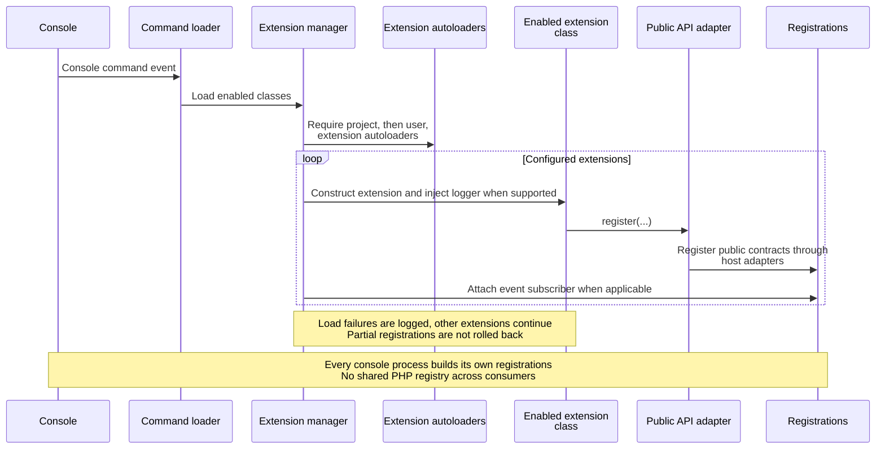
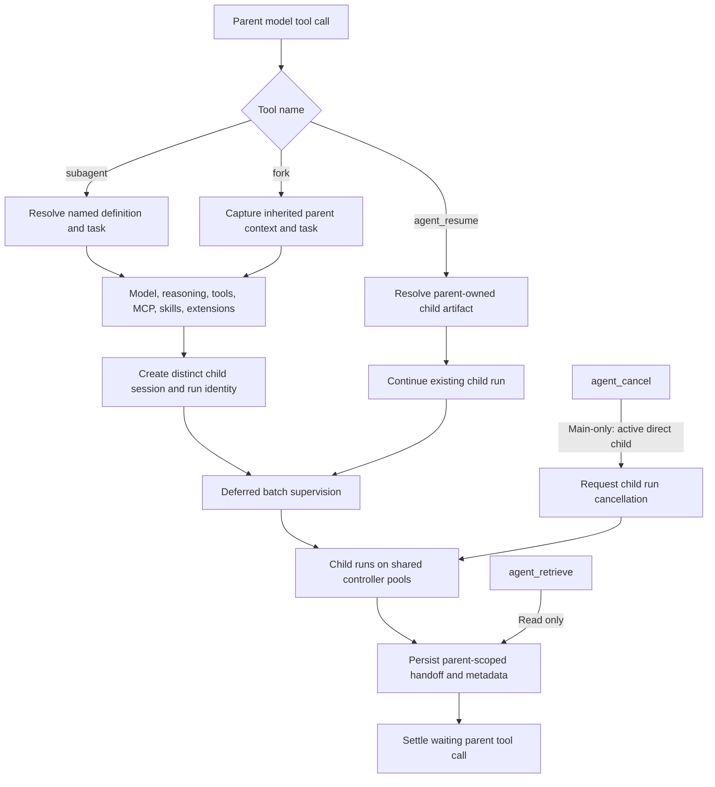
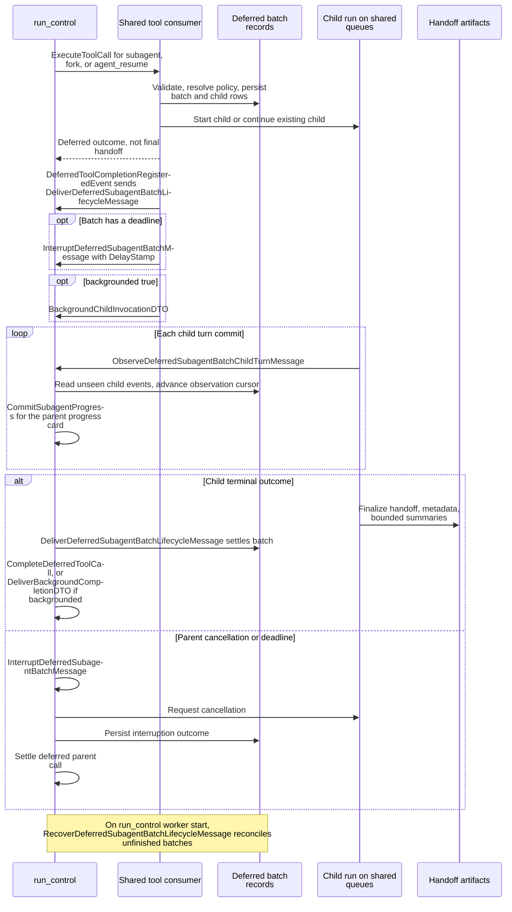
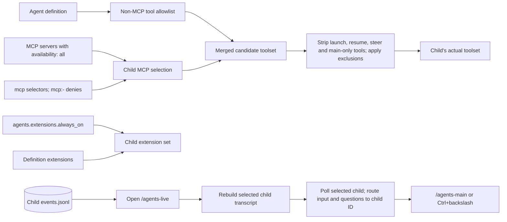
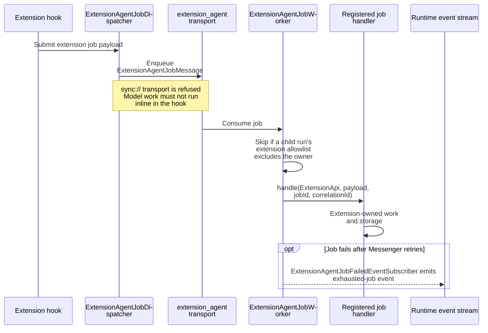

# Extensions and child agents

[Architecture map](README.md) · [Tools](tools-and-mcp.md) · [Background commands](backgrounding.md)

## Interactive startup update gate

`ExtensionUpdateStartupSubscriber` handles `ConsoleEvents::COMMAND` at priority
256, before `ExtensionLoaderSubscriber` at priority 0. Only the owning interactive
`agent` invocation participates; headless/controller/worker/child and noninteractive
commands do not. A process-local completion flag also excludes same-process
`/reload`, whose already-declared classes cannot be replaced.

`ExtensionUpdateService` reuses installation scope resolution and runs Composer
with `COMPOSER` pointing at disposable manifests/lockfiles under the kernel cache,
but with the installation as working directory to preserve relative repository
semantics. Update resolution uses `--no-install`; both stages disable scripts and
plugins. Serializer/Validator DTOs validate the resulting package metadata.
The preview compares the complete installed/target package sets, not just direct
extensions. Existing dev-dependency mode is retained.

Installation-local `auth.json` is copied beside the disposable manifest, where
Composer looks for local authentication. Planning directories are owner-only
(`0700`) and credential copies are `0600`; normal success/failure cleanup removes
them without changing the original or including credentials in the preview.

Yes applies each approved lock and runs its displayed `composer install`, avoiding
a second resolution after consent. Per-physical-root Symfony locks coordinate
Hatfield startups through a dedicated flock store under
`~/.hatfield/tmp/extension-update-locks`, shared across projects and source/PHAR
installations for the same user, not partitioned by `kernel.project_dir`.
All scope aliases and manifest/lock/auth/installed/autoloader hashes
are revalidated before any scope is updated and again before each install. Changed
inputs, failed resolution or installation, or a final package/lock mismatch abort
startup. A partially failed multi-scope update is not claimed atomic or rolled
back; no session starts. No leaves installation files unchanged. Cleanup removes
planning workspaces and releases locks before extension registration.

## Extension registration is process-local

Public ExtensionApi remains independent of AgentCore, CodingAgent, and in-repo TUI
classes. Packages use public contracts. The host owns adapters and runtime execution.
`ExtensionManager::loadSingle()` catches failures in construction, logger injection,
registration and subscriber attachment, records the failure and continues loading
other extensions. Partial registrations are not rolled back.

## Live session events

Public `Session\Event` classes reach subscribers only in the interactive process.
`JsonlProcessAgentSessionClient` decodes the controller stream in one place and
passes each event of the selected session's main run to
`ExtensionSessionEventPublisher`, which maps it with `ExtensionSessionEventMapper`
and dispatches it on the host dispatcher before the TUI reads the batch. The
client selects the session on `start()`, `attach()` and a first shell command, and
clears it on `shutdown()`. `AgentCommand` publishes the close after the interactive
loop returns; reload and switch already cleared the selection through `shutdown()`.

An attach publishes nothing until its `session.ready`, so bootstrap frames and the
catch-up suffix are not replayed; a recovery bootstrap suspends publishing again.
Canonical events below the published sequence are skipped after a controller
restart. Changes that bypass the controller, such as `/rename`, call the publisher
directly (`titleChanged()`), which publishes only for the selected session.
The TUI does not dispatch extension events itself. Extensions keep its context
for UI only and read the selected session through `ExtensionSessionContext`.
The in-process transport, which the controller also uses internally, publishes
nothing.

## Subagent, resume, and fork entry points

`agent_cancel` runs as an ordinary tool, only as a top-level call in an active main
run, for a direct child of the current parent lifetime whose originating call is
still on the parent's current branch. It returns `cancellation_requested`, not
proof that the child stopped. Steering and child notices use `agent_steer` and
`notify_parent`; see [agent communication](agent-communication.md).

| Property | Named subagent | Fork | Resume |
|---|---|---|---|
| Starting context | Agent definition, task, configured project context | Parent conversation context plus task | Existing child's retained context plus follow-up |
| Transport for launch tool | `agent` | Default `tool` | `agent` |
| Identity | New child | New child | Existing child |
| Role configuration | Named definition | Fork configuration and explicit allowed overrides | Existing child configuration |
| Completion | Deferred handoff | Deferred handoff | New handoff for continued child |

The `agent` transport is only a routing label: the same shared tool consumer reads
`tool` and `agent`, so launch, fork and resume share its capacity.

A fork is not a Git branch or worktree operation. Filesystem isolation must be chosen
by the implementation owner. Separate child identities alone do not prevent concurrent
writers from editing the same checkout.

## Durable supervision, not one controller per child

All supervision messages below route to `run_control`, the session's single state
owner, which handles parent and child runs alike.

Recovery uses durable child event cursors and reads the unseen event-log suffix.
Sequence allocation can leave holes, so `sequence.cursor` is not proof of a committed
event tail. Parallel batches wait for their required child outcomes; an initial
accepted launch is not a completed child turn.

## Child tool policy and live views

Optional parent extensions do not automatically propagate. Child answers must target
the child run, never whichever parent question happens to be latest. Artifacts cannot
be retrieved or resumed from an unrelated parent session.

## Extension agent jobs are a separate pipeline

The controller launches the `extension_agent` consumer only when at least one job
handler is registered. Recurring jobs from `registerRecurringJobSource()` take a
different route: `ExtensionRecurringJobRegistry` redispatches them to the `tool`
transport, where the shared tool consumer runs the same `ExtensionAgentJobWorker`.
See [scheduling](code-mode-and-scheduling.md#scheduling).

Observational memory is one such package: an after-turn hook enqueues its observer
job handler. Its jobs are not named subagents, and their results do not return as
`ToolCallResult` to the parent conversation.

Sources: [agents](../docs/agents.md), [agent settings](../docs/settings-agents.md),
[ExtensionManager](../src/CodingAgent/Extension/ExtensionManager.php),
[update service](../src/CodingAgent/Extension/ExtensionUpdateService.php),
[agent_cancel](../src/CodingAgent/Agent/Tool/AgentCancelTool.php),
[deferred batch supervision](../src/CodingAgent/Agent/Execution/Subagent/Batch/Deferred),
[child tool policy](../src/CodingAgent/Agent/Execution/AgentToolPolicyResolver.php),
[extension job worker](../src/CodingAgent/Extension/Agent/ExtensionAgentJobWorker.php),
[public Extension API](../.hatfield/extensions/extension-api/docs/extension-api.md),
[Messenger configuration](../config/packages/messenger.yaml).
