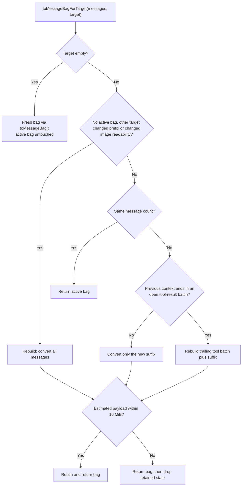

# Request-time history conversion

[Architecture](README.md) · [Context construction](context-and-projection.md)

Canonical `events.jsonl` never changes when switching providers/models.
`ImageGatingConvertHook` resolves image support for the exact qualified target model,
then `AgentMessageConverter::toMessageBagForTarget()` adapts current context at the
provider boundary.

| Target relationship | Conversion |
|---|---|
| Exact same qualified model | Keep call IDs unchanged, structured thinking and text/thinking signatures. ChatGPT streams composite `call_id\|item_id` IDs; keeping them lets the ChatGPT bridge restore the native function-call item ID |
| Different model/provider | Preserve message order, arguments and call/result associations; remap call IDs to bounded, sanitized, collision-safe names; `details.thinking` becomes ordinary text; ordered `thinking` parts, thinking signatures and `text_signature` (native message identity) are dropped |
| Text-only model | Before conversion, `ImageGatingConvertHook` replaces each `image_ref` part with a `[Tool result image: ...]` text placeholder |

Source model identity comes from request-local `source_model` metadata populated on
replay from `llm_step_completed.model`, not a second stored assistant-payload field.
Provider aliases do not choose conversion policy; exact `provider/model` identity
does. Unknown source identity takes the different-model path, so signatures are
treated as nonportable. Matching tool results inherit the assistant call's mapping.
Incomplete call/result batches are rejected earlier by
`AgentMessageToolCallSequenceValidator`, not repaired here.

## Worker-local bag

Each worker keeps one active target-aware `MessageBag`. Model switches, compaction,
history edits or non-prefix contexts fail the prefix check and rebuild. Generic
`toMessageBag()` callers always get a fresh bag. Request shapers rebuild messages
rather than mutating the supplied bag.

Retention is bounded three ways:

- **Size.** A conservative payload estimate over source messages and the converted bag
  (not PHP heap accounting) above `RETAINED_PAYLOAD_LIMIT` (16 MiB), or an
  unboundable graph, still returns the full bag but keeps nothing.
- **Idle.** `ConversionCacheIdleSubscriber` calls `evictIdleCache()` on idle
  `WorkerRunningEvent`s; the bag is dropped 60 seconds after its last use.
- **Image readability.** The converter records whether each `image_ref` path is a
  readable file. Image attachments read bytes at serialization, so any change forces
  a rebuild.

The converter deliberately does not implement `ResetInterface`, so Messenger service
resets keep incremental reuse across `ExecuteLlmStep` messages. No shared DB cache or
alternate canonical history is introduced.

Sources: [AgentMessageConverter](../src/AgentCore/Infrastructure/SymfonyAi/AgentMessageConverter.php),
[ConversationHistoryConversion](../src/AgentCore/Infrastructure/SymfonyAi/ConversationHistoryConversion.php),
[ConversionCacheIdleSubscriber](../src/AgentCore/Infrastructure/SymfonyAi/ConversionCacheIdleSubscriber.php),
[AgentMessageToolCallSequenceValidator](../src/AgentCore/Infrastructure/SymfonyAi/AgentMessageToolCallSequenceValidator.php),
[ImageGatingConvertHook](../src/CodingAgent/Tool/ImageProcessing/ImageGatingConvertHook.php);
composite ID splitting lives in the ChatGPT platform package's `ModelClient`.
