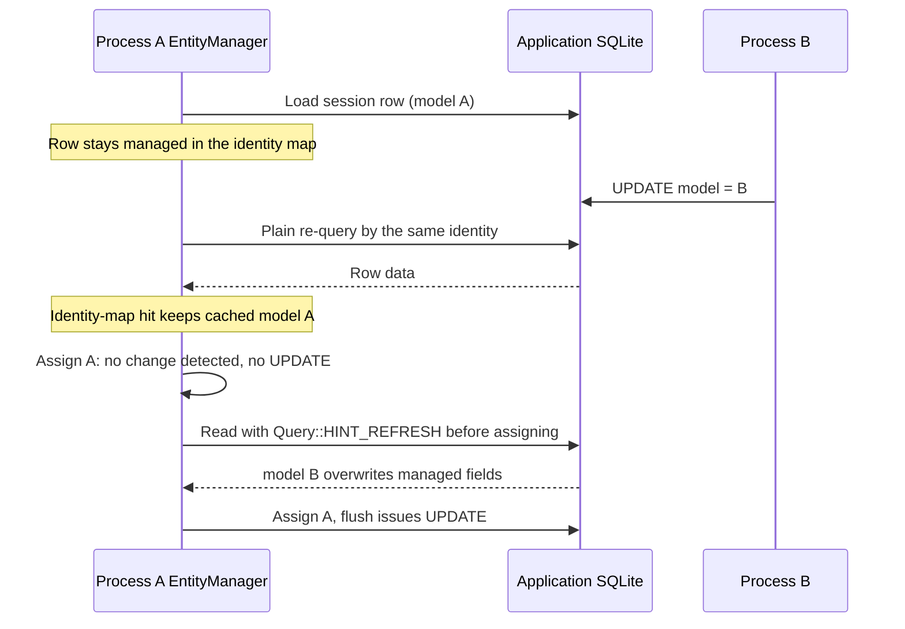

# Database freshness and ownership

[Architecture](README.md) · [State and recovery](state-and-recovery.md)

A Doctrine identity-map hit can return old fields after another process writes the
same row. Re-running a query is not necessarily a refresh. Mutable cross-process
reads need an explicit freshness boundary; they do not justify clearing the entire
EntityManager before every query.

## Current boundaries

| Area | Read/write boundary |
|---|---|
| Session catalog | `HatfieldSessionRepository::findForCatalog()` uses scalar DBAL rows; existence (`existsById()`), goal and relationship reads use dedicated SQL queries. |
| Run operational projection | `RunOperationalProjectionRepository::replace()` rewrites the disposable, payload-free projection from canonical `RunState` inside `wrapInTransaction()`; cross-process status and relationship reads are scalar DBAL rows. |
| Deferred completion | `DeferredToolCompletionRepository` reads mutable entities through `findFreshOneBy()` with `Query::HINT_REFRESH`; conditional SQL completion detaches a matching managed entity. |
| Deferred batches and children | Repositories use targeted fresh entity reads (`findFreshOneBy()`, `HINT_REFRESH` header queries), scalar candidate queries and version/status-checked writes. `DeferredSubagentBatchRepository` clears the whole EntityManager after committing child-lifecycle projection, launch-failure preparation and launch-success transactions. |
| Background Bash | `ProcessStore` reads immutable scalar snapshots and performs conditioned DBAL writes. No managed process entity crosses a cooperative wait. |
| Background process and completion receipts | `BackgroundProcessRepository` (code-mode launch state) and `BackgroundCompletionReceiptRepository` query and write through DBAL only. |
| Run-control worker failure | `RunControlDoctrineFailureResetSubscriber` closes the DBAL connection and resets the manager after a failed `run_control` message, so later messages do not reuse an EntityManager closed by a failed transaction. |
| Queue broker | The session-owned sqlite-queue broker process and its async SQLite helper own transport rows; Messenger clients reach it over sockets. ORM refresh does not affect queue delivery. |
| Extension storage | Concrete packages own their storage. Observational memory is a thin client of the external Librarian and keeps no host database state. |

## Stale identity-map read

## Invariants

- Refresh mutable fields **before** assigning new values. Refreshing afterwards
  can erase the pending update.
- Check current identity/version/status when mutating. A fresh candidate snapshot
  is an observation, not authorization to signal a process or settle a lifecycle.
- Do not retain managed entities across suspended Fibers or outside their owner
  transaction. Pass immutable scalar snapshots to execution work.
- Fiber consumers disable per-message service reset. Clearing shared services
  after one handler would invalidate suspended siblings.
- Targeted refresh/detach does not replace SQL uniqueness, optimistic locking,
  session ownership or exact native-process evidence.
- Explicit transaction-completion clears in repositories are not permission to
  add blanket clears in nested helpers or execution handlers.

Example failure: a cached session says model A, another process writes B, then the
user selects A. Assigning A to an already-A cached entity can produce no update.
The operation must read current fields before deciding or assigning the selection.

Sources: [session repository](../src/CodingAgent/Entity/HatfieldSessionRepository.php),
[operational projection](../src/CodingAgent/Repository/RunOperationalProjectionRepository.php),
[deferred completions](../src/CodingAgent/Entity/DeferredToolCompletionRepository.php),
[batches](../src/CodingAgent/Entity/DeferredSubagentBatchRepository.php),
[children](../src/CodingAgent/Entity/DeferredSubagentChildRepository.php),
[process store](../src/CodingAgent/Tool/BackgroundProcess/ProcessStore.php),
[background processes](../src/CodingAgent/Entity/BackgroundProcessRepository.php),
[completion receipts](../src/CodingAgent/Entity/BackgroundCompletionReceiptRepository.php),
[failure reset](../src/CodingAgent/Runtime/Messenger/RunControlDoctrineFailureResetSubscriber.php),
[queue broker supervisor](../src/CodingAgent/Runtime/Messenger/SessionSqliteQueueBrokerSupervisor.php),
[Fiber consumer](../src/CodingAgent/Runtime/Messenger/LlmFiberConsumeCommand.php).
