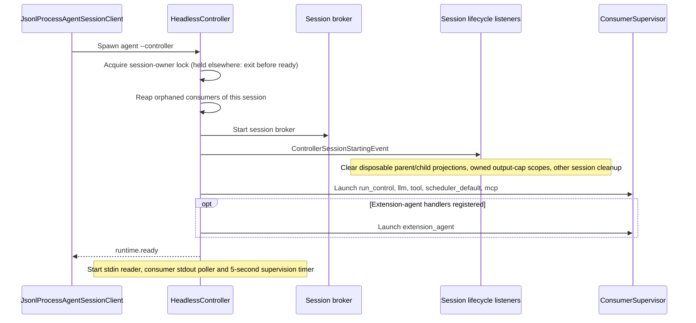
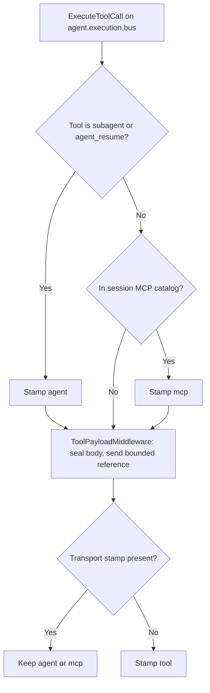
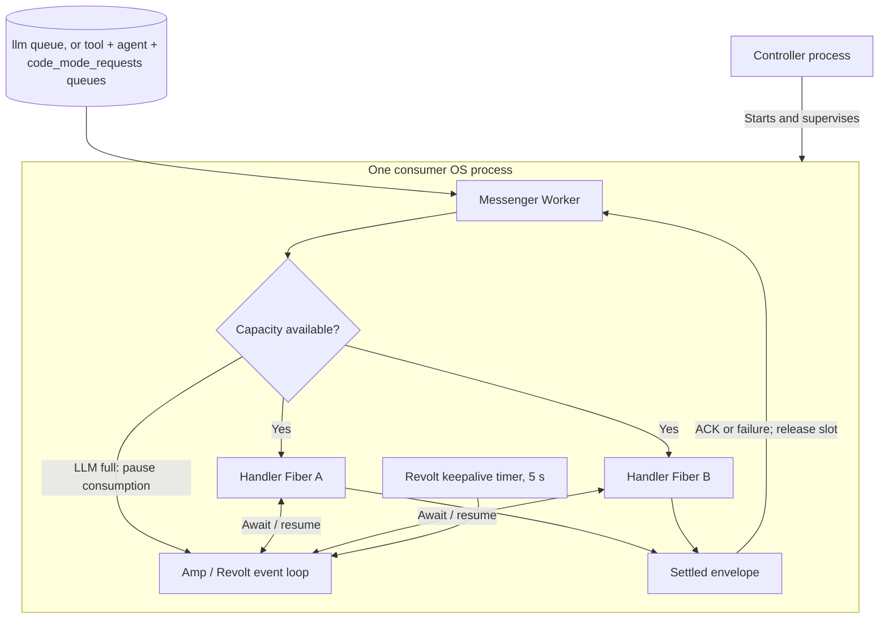
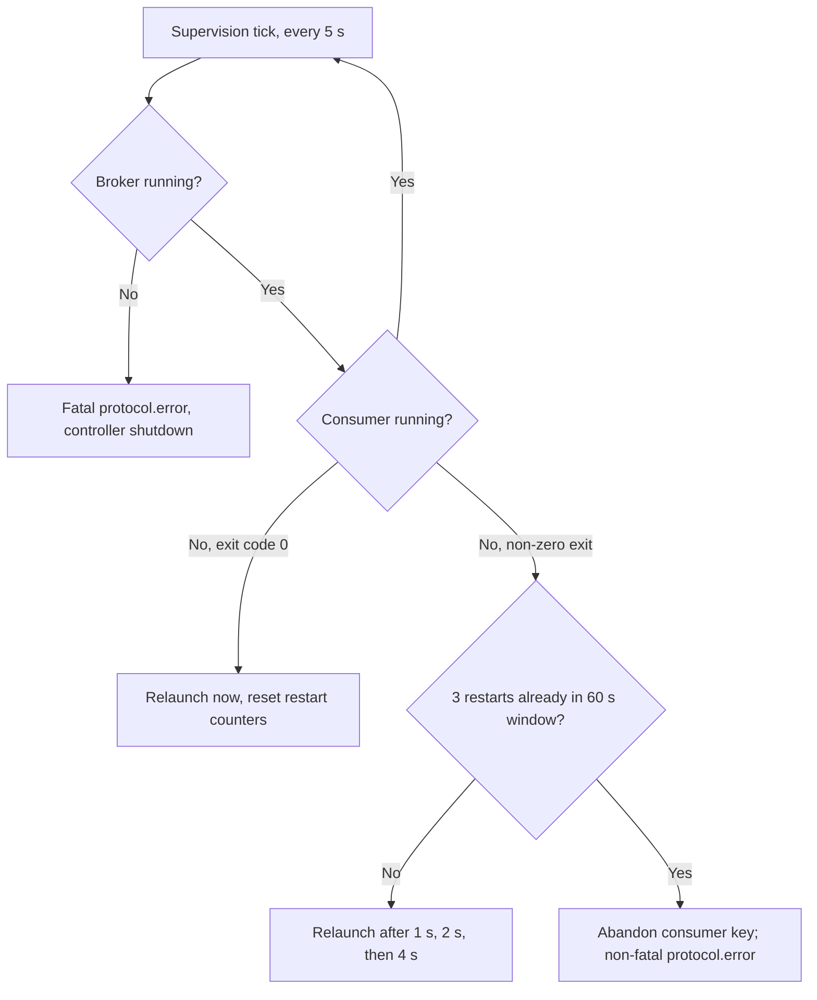
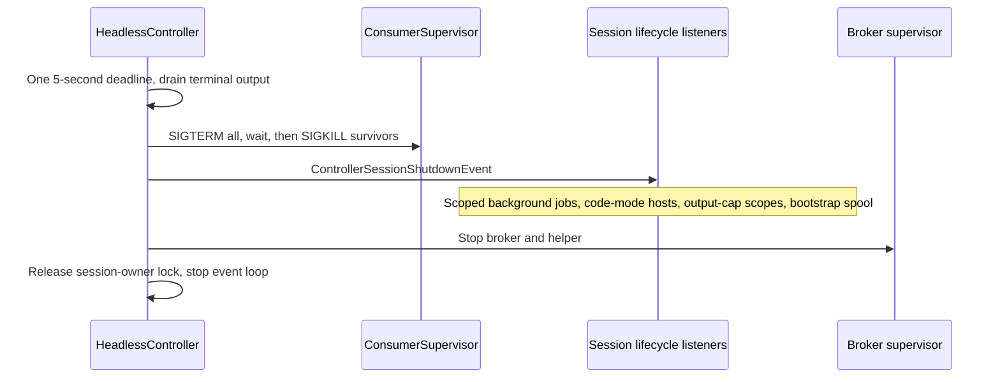

# Processes and queues

[Architecture](README.md) · [Runtime supervision](runtime.md)

## Startup

1. `ExtensionLoaderSubscriber` loads enabled registrations on
   `ConsoleEvents::COMMAND` in every console process, including consumers.
2. `AgentCommand` prepares configuration and startup databases. The TUI creates
   its `AgentSessionClient`; process mode starts `agent --controller` over JSONL
   and waits up to 15 seconds for `runtime.ready`.
3. `HeadlessController` runs the sequence below. `runtime.ready` means the
   transport is usable, not that a provider request succeeded or a resumed
   transcript is attached. `session.ready` marks attach completion.

Orphan reaping only stops processes whose parent is init, whose UID is ours,
whose environment carries this exact `HATFIELD_SESSION_ID`, and whose CWD is this
project. A broker or listener failure before consumer launch stops the broker and
releases the lock; a consumer launch failure also stops started consumers and
dispatches `ControllerSessionShutdownEvent` before rethrowing.

The broker and its async SQLite helper are distinct from the application DB
connection to `.hatfield/state.sqlite`.

## Routing and owners

| Consumer process | Queues / responsibility |
|---|---|
| `run_control` | Serialized commands, results, canonical transitions and lifecycle metadata |
| `llm` | `ExecuteLlmStep` and `ExecuteCompactionStep`; internal admission limit of **10** |
| Shared `tool` | `tool`, `agent` and `code_mode_requests` queues: tools, direct shell, code-mode tool requests, child launch/resume, recurring extension jobs |
| `mcp` | MCP initialize/refresh/disconnect and MCP-backed tool calls; one consumer per session, serialized |
| `extension_agent` | Ordinary extension-agent job dispatch; launched only if handlers are registered |
| `scheduler_default` | Symfony Scheduler recurring messages, not a durable broker queue |

Messages routed to `run_control` in `config/packages/messenger.yaml`:

| Group | Messages |
|---|---|
| Run transitions and results | `StartRun`, `ApplyCommand`, `ApplyShellCommand`, `AdvanceRun`, `CompactRun`, `LlmStepResult`, `CompactionStepResult`, `CommitSubagentProgress` |
| Session maintenance | `AttachRun`, `SelectHistoryEntry`, `RepairSession` |
| Background work | `RequestBashBackgroundDTO`, `BackgroundChildInvocationDTO`, `BackgroundCodeModeInvocationDTO`, `DeliverBackgroundCompletionDTO` |
| Agent communication | `AcceptSubmissionDTO`, `CompleteSubmissionDTO`, `DeliverSubmissionDTO` |
| Deferred subagent batches | Observe child turn, deliver lifecycle, interrupt and recover lifecycle messages |

Tool results and deferred completions have no YAML route; `ToolPayloadMiddleware`
stamps them for `run_control`.

`StepDispatcher` sends coordination actions and non-execution effects such as
`AdvanceRun` and `CompactRun` to `agent.command.bus`, and `Execute*` effects to
`agent.execution.bus`. Tool calls are routed by middleware, in this order:

Fork and direct shell (`ExecuteShellToolCall`) use the ordinary tool route.
`ToolPayloadMiddleware` replaces large bodies with validated immutable file
references while retaining routing. Scheduler-generated extension jobs are
redispatched to the `tool` transport; `ExtensionAgentJobDispatcher` sends
ordinary jobs to `extension_agent` and refuses a `sync://` transport.

## Cooperative execution

The LLM and shared tool roles run `hatfield:messenger:consume-llm --transport=llm|tool`.
Other consumers run stock `messenger:consume <transport>`. All use
`--memory-limit=256M`; broker-backed consumers add `--keepalive=5`.
`LlmFiberConsumeCommand` builds a Messenger `Worker` using
`FiberMessageExecutionStrategy`; it is not Messenger's child-process parallelism.

- LLM capacity counts active handlers, not child runs or HTTP connections. The
  LLM fetch size equals that limit.
- The shared tool consumer and parallel batches have no numeric admission cap.
  Sequential and Interrupt calls retain exclusive ordering barriers. A tool
  consumer also opens a per-slot code-mode reply receiver.
- Deferred child launch returns before child completion. Later child LLM/tool
  work uses the same consumers.
- Amp HTTP, retry delays and subprocess supervision yield. Synchronous CPU,
  filesystem/database calls or blocking extensions still stall peers in that
  consumer. Fibers are not CPU parallelism.
- Idle receive uses cooperative broker WAIT integration
  (`LlmFiberConsumeWaitSubscriber`). A Revolt timer, not `SIGALRM`, renews leases
  every five seconds while the event loop can run. Stock consumers use Messenger's
  native keepalive.

## Shared services and persistence

Per-message service reset is disabled in Fiber consumers: resetting a shared
service after one handler would invalidate suspended siblings. Instead, tool
context stacks, logging/tracing scopes and reentrant run-lock ownership are
Fiber-local. Managed ORM entities must not escape an owner transaction into a
suspended handler; use scalar snapshots for execution reads.

`run_control` commits transitions and dispatches immutable execution intents.
Execution handlers own same-intent idempotency:

- Bash records native launch/background evidence locally and returns an ordinary
  result. Matching replay evidence is reused; unverifiable evidence fails closed.
- Agent handlers reserve/reuse the child locally; communication handlers create
  their submission locally. The worker registers returned deferred correlation,
  without a lifecycle-registration RPC handshake.
- Code mode registers correlation after policy/budget checks and marks readiness
  after accepting its socket. A ready row is not proof of host liveness and does
  not recover a dead script host. See [code mode](code-mode-and-scheduling.md).

A query is an observation, not permission to signal a process. Bash validates
exact native evidence and process-group ownership before stopping anything.

## Shutdown and failure

`ConsumerSupervisor::supervise()` runs on the controller's 5-second timer, after
the broker check:

Exit code 0 is the graceful memory-recycle path and is not rate-limited.
Restarting a worker is not repair of a stranded effect. Broker death is terminal
for the session; there is no transparent queue reconnect. Delivery remains
at-least-once. See [state and recovery](state-and-recovery.md).

Stdin EOF (parent disconnected), `SIGTERM`, `SIGINT`, a failed stdout write and
broker exit all enter the same idempotent `shutdown()`:

The parent client's stop grace is 7 seconds, longer than the controller's shared
deadline. On later startup a controller must acquire the same session-owner lock
before reaping matching leftovers. Accepted background Bash survives worker
recycling, not controller shutdown. Code-mode scripts also survive worker
recycling. Shared workers deliver normal completion; the controller supervises
the script and can recover a retained terminal report after confirmed exit.

Sources: [HeadlessController](../src/CodingAgent/Runtime/Controller/HeadlessController.php),
[ConsumerSupervisor](../src/CodingAgent/Runtime/Controller/ConsumerSupervisor.php),
[Fiber strategy](../src/CodingAgent/Runtime/Messenger/FiberMessageExecutionStrategy.php),
[consumer command](../src/CodingAgent/Runtime/Messenger/LlmFiberConsumeCommand.php),
[StepDispatcher](../src/AgentCore/Application/Handler/StepDispatcher.php),
[Messenger routes](../config/packages/messenger.yaml),
[ToolPayloadMiddleware](../src/CodingAgent/Runtime/Messenger/ToolPayloadMiddleware.php),
[recurring extension jobs](../src/CodingAgent/Extension/ExtensionRecurringJobMessageProvider.php).
