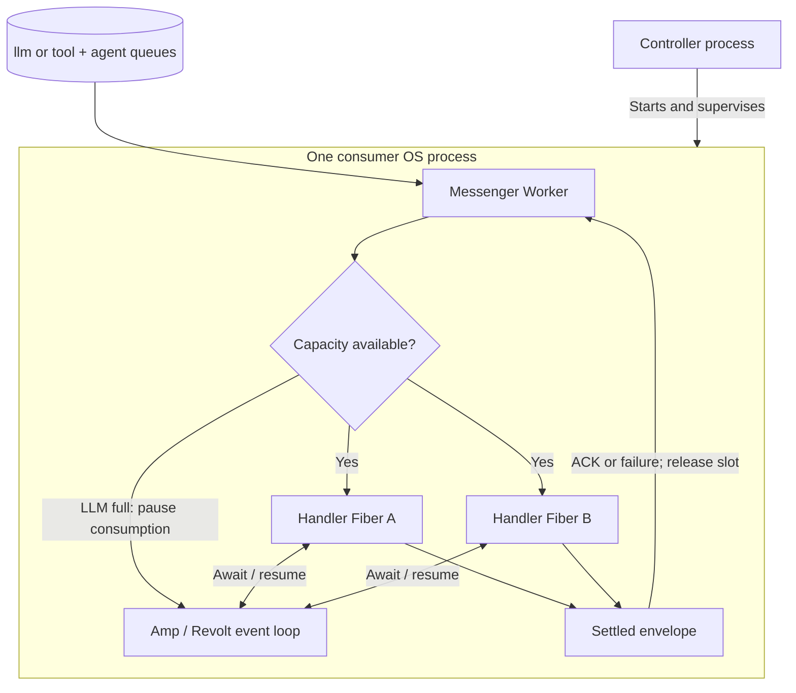

# Processes and queues

[Architecture](README.md) · [Runtime supervision](runtime.md)

## Startup

1. `ExtensionLoaderSubscriber` loads enabled registrations on
   `ConsoleEvents::COMMAND` in every console process, including consumers.
2. `AgentCommand` prepares configuration and startup databases. The TUI creates
   its `AgentSessionClient`; process mode starts `agent --controller` over JSONL.
3. The controller acquires the session-owner lock before cleaning matching
   orphan consumers and disposable parent/child operational projections.
4. It starts the session broker and consumers, then publishes `runtime.ready`.
   This means the transport is usable, not that a provider request succeeded or
   a resumed transcript is attached. `session.ready` marks attach completion.

The broker and its async SQLite helper are distinct from the application DB
connection to `.hatfield/state.sqlite`.

## Routing and owners

| Consumer process | Queues / responsibility |
|---|---|
| `run_control` | Serialized commands, results, canonical transitions and lifecycle metadata |
| `llm` | LLM and compaction handlers; `runtime.llm_concurrency` defaults to **10** |
| Shared `tool` | Both `tool` and `agent` queues; tools, Bash, code mode, child launch/resume, recurring extension jobs |
| `mcp` | MCP calls and connection lifecycle, serialized |
| `extension_agent` | Ordinary extension-agent dispatch; omitted if no handlers are registered |
| `scheduler_default` | Symfony Scheduler recurring messages, not a durable broker queue |

`StepDispatcher` sends transitions to `agent.command.bus` and effects to
`agent.execution.bus`. `ExecuteToolCall` normally routes to `tool`; subagent
launch/resume middleware stamps `agent`, then MCP middleware stamps MCP-owned
calls only if no transport stamp exists. Fork uses the ordinary tool route.
`ToolPayloadMiddleware` retains routing while replacing large bodies with
validated immutable file references. Results return to `run_control`.

## Cooperative execution

The LLM and shared tool roles run `hatfield:messenger:consume-llm`.
`LlmFiberConsumeCommand` builds a Messenger `Worker` using
`FiberMessageExecutionStrategy`; it is not Messenger's child-process parallelism.

- LLM capacity counts active handlers, not child runs or HTTP connections.
- The shared tool consumer has no worker admission cap.
  `tools.execution.max_parallelism` separately bounds each tool batch.
- Deferred child launch returns before child completion. Later child LLM/tool
  work uses the same consumers.
- Amp HTTP, retry delays and subprocess supervision yield. Synchronous CPU,
  filesystem/database calls or blocking extensions still stall peers in that
  consumer. Fibers are not CPU parallelism.
- Idle receive uses cooperative broker WAIT integration. A Revolt timer renews
  leases every five seconds while the event loop can run.

## Shared services and persistence

Per-message service reset is disabled in Fiber consumers: resetting a shared
service after one handler would invalidate suspended siblings. Instead, tool
context stacks, logging/tracing scopes and reentrant run-lock ownership are
Fiber-local. Managed ORM entities must not escape an owner transaction into a
suspended handler; use scalar snapshots for execution reads.

`run_control` commits transitions and dispatches immutable execution intents.
Execution handlers own same-intent idempotency:

- Bash records native launch/background evidence locally and returns an ordinary
  result. Matching replay evidence is reused; unverifiable evidence fails closed.
- Agent handlers reserve/reuse the child locally; communication handlers create
  their submission locally. The worker registers returned deferred correlation,
  without a lifecycle-registration RPC handshake.
- Code mode registers correlation after policy/budget checks and marks readiness
  after accepting its socket. A ready row is not proof of host liveness and does
  not recover a dead script host. See [code mode](code-mode-and-scheduling.md).

A query is an observation, not permission to signal a process. Bash validates
exact native evidence and process-group ownership before stopping anything.

## Shutdown and failure

The controller stops owned consumers, scoped background jobs, then the broker
and helper. On later startup it must acquire the same session-owner lock before
reaping matching leftovers. Accepted background Bash survives worker recycling,
not controller shutdown. Code-mode scripts depend on the original host worker.

Consumer restarts are bounded to **3 per key in 60 seconds**. Restarting a worker
is not repair of a stranded effect. Broker death is terminal for the session;
there is no transparent queue reconnect. Delivery remains at-least-once.
See [state and recovery](state-and-recovery.md).

Sources: [ConsumerSupervisor](../src/CodingAgent/Runtime/Controller/ConsumerSupervisor.php),
[Fiber strategy](../src/CodingAgent/Runtime/Messenger/FiberMessageExecutionStrategy.php),
[consumer command](../src/CodingAgent/Runtime/Messenger/LlmFiberConsumeCommand.php),
[Messenger routes](../config/packages/messenger.yaml),
[ToolPayloadMiddleware](../src/CodingAgent/Runtime/Messenger/ToolPayloadMiddleware.php).
