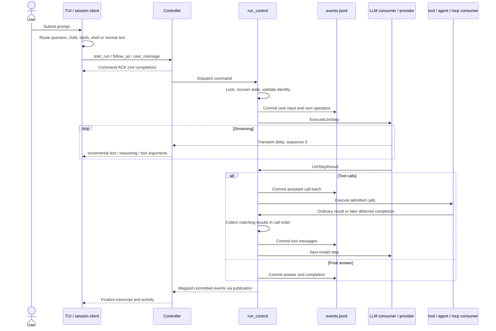

# Request lifecycle

[Architecture](README.md) · [Processes](processes-and-queues.md) · [State](state-and-recovery.md)

## Prompt to response

The loop repeats until completion, cancellation, a human wait or failure.
`RunCommit` dispatches effects after canonical append; the publication arrows do
not imply a direct call to the controller. Worker stdout is delivery, not history.

## Input before execution

`SubmitListener` routes in this order: active question, child live-view policy,
local command handling, then parent prompt handling.

- Slash commands go to the registry/prompt expansion; shell input uses the shell
  path. An existing absolute file/directory path is normal text, not a slash command.
- First real prompt promotes a draft and starts a run. Idle/terminal runs receive
  a follow-up; active runs receive steering input at a safe model boundary.
- Cancellation/compaction can retain pending follow-ups until settlement.
- Normal input becomes a transcript row from its canonical event, not an
  optimistic duplicate added by the screen.

## Advance and failure boundaries

`AdvanceRunHandler` drains accepted mailbox commands, checks cancellation and
compaction, then commits and dispatches the next LLM operation. Results must match
the active operation. Tool calls form a durable batch; admission respects tool
mode and batch capacity. Results are collected in invocation order even when
workers finish out of order.

Tool errors can be model-visible results without ending the run. Provider failure,
transport failure and ordinary tool errors are different outcomes. Compaction
failure retains original messages; cancellation wins over continuation.
See [state and recovery](state-and-recovery.md) and [tool execution](tools-and-mcp.md).

Sources: [SubmitListener](../src/Tui/Listener/SubmitListener.php),
[controller](../src/CodingAgent/Runtime/Controller/HeadlessController.php),
[RunMessageProcessor](../src/AgentCore/Application/Pipeline/RunMessageProcessor.php),
[RunCommit](../src/AgentCore/Application/Pipeline/RunCommit.php),
[LLM adapter](../src/AgentCore/Infrastructure/SymfonyAi/LlmPlatformAdapter.php).
