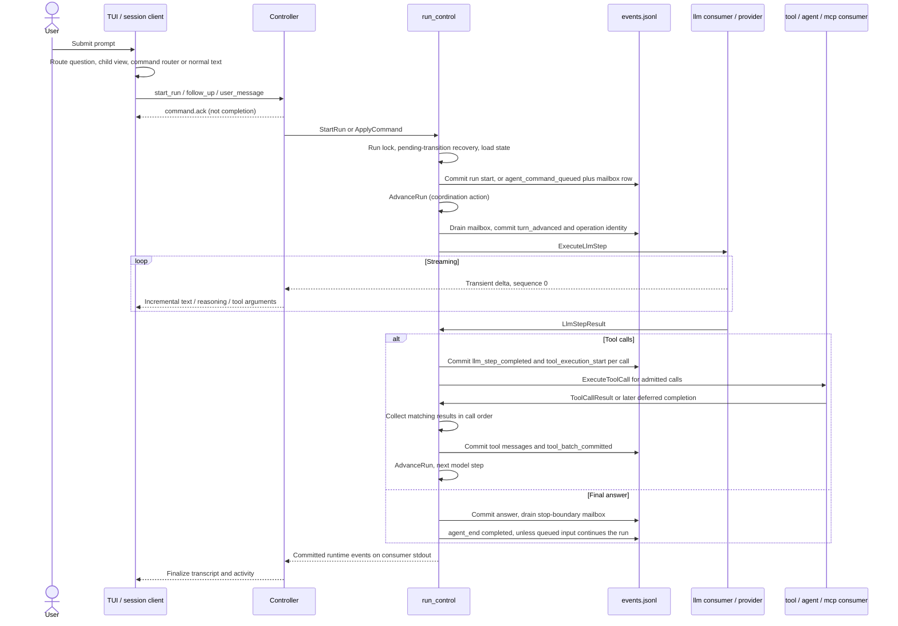
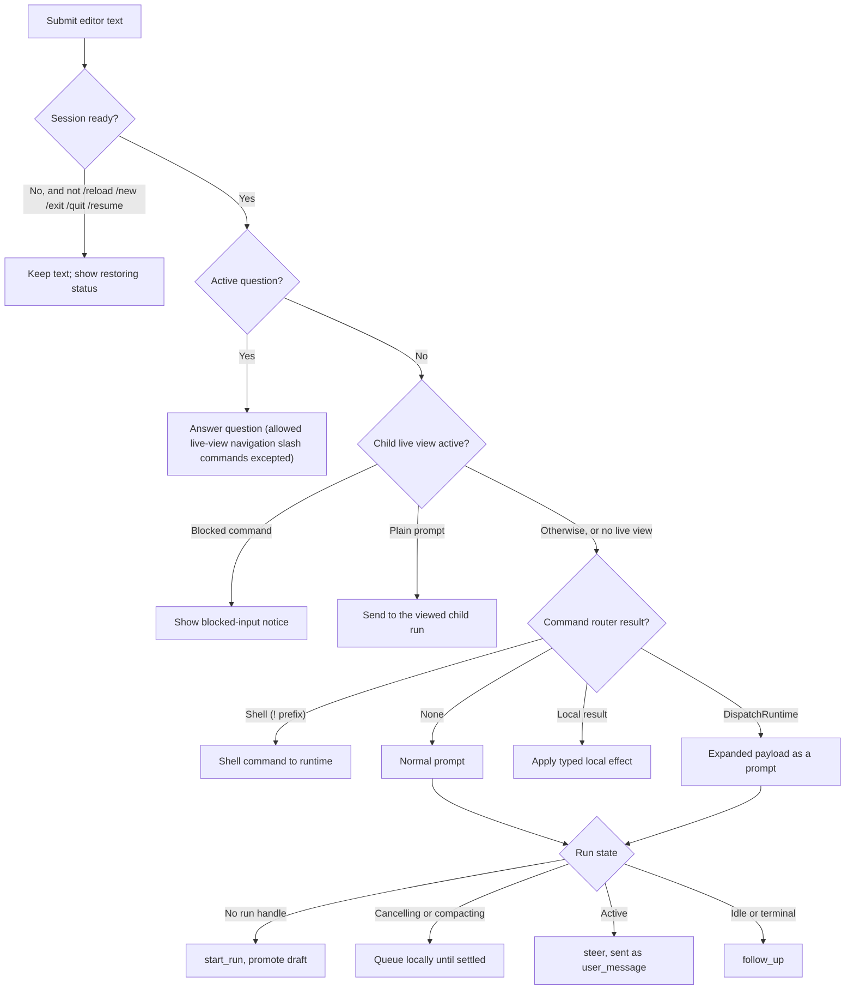
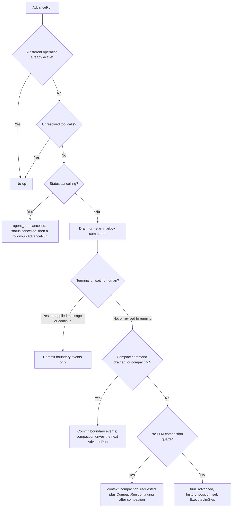

# Request lifecycle

[Architecture](README.md) · [Processes](processes-and-queues.md) · [State](state-and-recovery.md)

## Prompt to response

The loop repeats until completion, cancellation, a human wait or failure.
`RunCommit` dispatches effects after canonical append and after the run lock is
released; the publication arrows do not imply a direct call to the controller.
Worker stdout is delivery, not history. Subagent and `agent_resume` calls run on
the `agent` queue and MCP-backed calls on `mcp`; their results and deferred
completions return to `run_control` like ordinary tool results.

## Input before execution

`SubmitListener` routes in this order:

- `CommandParser` treats text starting with an existing file or directory path
  as a normal prompt, not a slash command.
- On the runtime, steer and follow-up are queued in the pending-command mailbox
  while the run is running, cancelling or compacting, and drained at the next
  stop boundary or turn start. A non-active run gets an immediate `AdvanceRun`.
- Normal input becomes a transcript row from its canonical event, not an
  optimistic duplicate added by the screen.

## Advance and failure boundaries

`AdvanceRunHandler` decides the next operation under the run lock:

`CompactRun` runs on `run_control`, sets the run to `compacting` and sends
`ExecuteCompactionStep` to the `llm` queue; `CompactionStepResult` returns to
`run_control`, which resumes with `AdvanceRun` when the compaction held a pending
turn. Results must match the active operation. Tool calls form a durable batch;
admission respects tool mode and batch capacity. Results are collected in
invocation order even when workers finish out of order. An `ask_human` result or
an in-flight human-input request moves the run to `waiting_human`; an answer
resumes it.

Before any handler runs, `RunMessageProcessor` checks that no canonical
transition is still pending, drops an `ApplyCommand` whose key is already in the
pending mailbox, and commits a separate `history_tail_discarded` event when a
context-mutating command arrives while an earlier history entry is selected.

Tool errors can be model-visible results without ending the run. Provider failure,
transport failure and ordinary tool errors are different outcomes. Compaction
failure retains original messages; cancellation wins over continuation.
See [state and recovery](state-and-recovery.md) and [tool execution](tools-and-mcp.md).

Sources: [SubmitListener](../src/Tui/Listener/SubmitListener.php),
[CommandParser](../src/Tui/Command/CommandParser.php),
[controller](../src/CodingAgent/Runtime/Controller/HeadlessController.php),
[RunMessageProcessor](../src/AgentCore/Application/Pipeline/RunMessageProcessor.php),
[AdvanceRunHandler](../src/AgentCore/Application/Pipeline/AdvanceRunHandler.php),
[ApplyCommandHandler](../src/AgentCore/Application/Pipeline/ApplyCommandHandler.php),
[LlmStepResultHandler](../src/AgentCore/Application/Pipeline/LlmStepResultHandler.php),
[ToolCallResultHandler](../src/AgentCore/Application/Pipeline/ToolCallResultHandler.php),
[RunCommit](../src/AgentCore/Application/Pipeline/RunCommit.php),
[LLM adapter](../src/AgentCore/Infrastructure/SymfonyAi/LlmPlatformAdapter.php).
