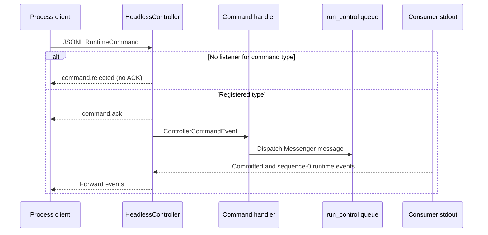
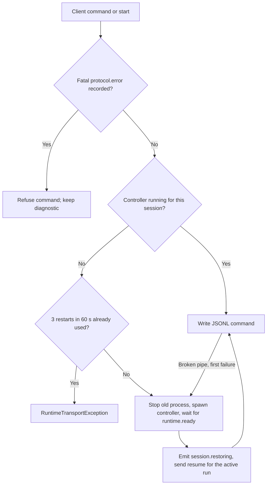

# Runtime supervision

[Architecture](README.md) · [Processes and queues](processes-and-queues.md)

The TUI uses `AgentSessionClient`. Production process mode
(`JsonlProcessAgentSessionClient`, the `--transport=process` default) talks to a
session controller through long-lived JSONL stdin/stdout pipes. Inside the
controller, command handlers use `InProcessAgentSessionClient` to dispatch
Messenger messages onto the session queues. Selecting `--transport=in-process`
for the TUI uses that client directly; the CLI option labels this mode broken
since the queue-based runtime, so do not treat it as a supported alternative.
The controller owns the session lock, broker and consumer processes, not run
transitions.

`AgentSessionClient::send()` takes a `UserCommand` with a `UserCommandTypeEnum`.
Process mode maps `message` and `steer` to the `user_message` wire command; other
types keep their enum value (for example `follow_up`). The `cancel` discriminator
is not supported by `send()`; callers use the separate cancellation APIs.
`RuntimeCommand` wire discriminators remain strings.

## Admission and delivery

The controller ACKs a supported command before dispatch, so an accepted command
can still fail at dispatch or execution. `run_control` owns canonical state
changes, and `RuntimeEventMapper` / `RuntimeEventTranslator` map committed
`RunEvent` values into protocol DTOs. They do not consume `RunState`. LLM stream
events are transient sequence-0 deltas. Partial stdout records remain buffered
until their newline, both in the controller's consumer poller and in the client.

## Controller replacement

A session change also replaces the controller so consumers inherit the new
session's queue DSNs; that restart does not count toward the budget. The broken
pipe retry happens once per command.

## Failure boundaries

| Failure | Behavior |
|---|---|
| Consumer exits with code 0 | Memory recycle: relaunched immediately, no restart budget |
| Consumer exits non-zero | Restarted with 1/2/4-second backoff, at most 3 times per 60 seconds per key; not a guarantee the current effect is replayed |
| Consumer exceeds restart budget | Abandoned; controller emits a non-fatal `protocol.error` naming the transport and keeps running |
| Lease renewal fails | Messenger logs a warning; it does not stop the handler. Expired leases allow redelivery |
| Broker dies | Controller emits fatal `protocol.error`, then shuts down. Client keeps that diagnostic and refuses commands rather than transparently reconnecting |
| Parent disconnects or signals | Stdin EOF, `SIGTERM` or `SIGINT` runs the ordinary controller shutdown |
| Unexpected nonfatal controller loss | Process client can replace the controller and reattach within its restart budget; durable history and operational evidence govern recovery |
| Canonical commit succeeds, later publication fails | Events remain authoritative; discard owner-local state and reconstruct before continuing |

Fatal diagnostics survive parent, child and session-wide polling until an explicit
start, attach or shutdown resets the client boundary. The TUI marks the session
failed rather than hiding the original broker failure behind a generic reconnect.
`/repair` is explicit; see [recovery](state-and-recovery.md).

## Limits

- Broker lease (`redeliver_timeout`): **60 seconds**; keepalive interval: **5 seconds**.
- Consumer restart budget: **3 per key in 60 seconds** for non-zero exits,
  initial delay **1 second**, doubling.
- Controller restart budget in the process client: **3 in 60 seconds**.
- Wait for `runtime.ready`: **15 seconds**. Attach bootstrap timeout: **60 seconds**.
- Controller shutdown deadline shared by consumers, listeners and broker:
  **5 seconds**; parent client stop grace: **7 seconds**.
- Stderr diagnostic tail per consumer and for the broker: **16,384 bytes**.
- Worker memory recycle threshold: **256 MiB**; no message-count recycle boundary.
- Queue `max_payload`: **1,000,000,000 bytes**, configured in
  `config/packages/sqlite_queue.yaml`. This is independent of the bounded
  disposable transcript-bootstrap spool (**8 MiB**).
- `SessionSqliteQueueBrokerTopology` derives required connections from the resolved
  consumer topology. Controller readiness rejects insufficient advertised budgets.

`HATFIELD_BINARY_PATH` chooses the subprocess executable for source, PHAR and
static builds. MCP disconnect and process cancellation are best-effort, not a
sandbox or rollback guarantee. Extension load failures are caught and logged;
loading continues without rolling back partial registrations.

Sources: [process client](../src/CodingAgent/Runtime/Process/JsonlProcessAgentSessionClient.php),
[in-process client](../src/CodingAgent/Runtime/InProcess/InProcessAgentSessionClient.php),
[controller](../src/CodingAgent/Runtime/Controller/HeadlessController.php),
[ConsumerSupervisor](../src/CodingAgent/Runtime/Controller/ConsumerSupervisor.php),
[bootstrap delivery](../src/CodingAgent/Runtime/Controller/SessionBootstrapDelivery.php),
[queue configuration](../config/packages/sqlite_queue.yaml).
