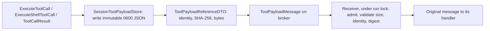

# Session runtime storage

[Architecture](README.md) · [State and recovery](state-and-recovery.md)

## Owner-local state and indexed history

Run control reconstructs a cold run from canonical events and retains one current
`RunState` in its owner-local registry. Canonical append precedes operational
projection and memory replacement. Failed publication invalidates owner-local
state so the next operation reconstructs rather than trusting a partial cache.

`run_operational_state`, `run_operational_tool_call` and
`run_operational_human_input` contain payload-free indexed coordination data.
Controller startup acquires the owner lock and clears disposable parent/child
projection rows before starting consumers. Execution workers read narrow scalar
status snapshots for cancellation; they do not mutate `RunState`.

The disposable `history-index.sqlite` stores committed record locations, immutable
turn anchors and bounded previews, not prompt bodies. Missing/invalid indexes
trigger a streaming metadata pass; replay then reads selected records. Sequence
allocation may leave holes, so `sequence.cursor` is never an event-tail oracle.
Parent attach recovers state and display products in one owner-led replay.
The private bootstrap spool contains bounded transcript blocks and scalar resume
metadata, never `RunState` or raw event archives. Exact-cut acknowledgement releases
it before canonical suffix catch-up and `session.ready`.

## Pending commands and tool payloads

- `run_command` retains pending bodies only. Apply/reject deletes the row; completed
  command IDs are not a durable deduplication ledger. Resubmission can repeat input.
- Active batch rows retain scheduling order, admission and human/deferred waits.
  Call/result rows hold bounded references, not serialized envelopes or arguments.
- Bodies live in private immutable JSON files under the run's session (or child
  artifact) directory at
  `runtime/tool-payloads/<call-id-sha256>/<body-sha256>.json`. A retained
  first-result reference sits beside them as `first-<sha256>.json`, keyed by turn,
  step, attempt, operation key and order. References carry producer identity,
  SHA-256 and byte length, never arbitrary paths.
- Tool attachments live at
  `runtime/tool-attachments/<call-id-sha256>/<random>.txt`. Transcript
  references point at them, so they outlive batch bodies and remain until
  permanent session deletion.
- Publication seals files before SQL/transport references become visible. Reads
  validate size, identity and digest. Missing/corrupt **active** data fails closed;
  superseded deliveries need not reopen legitimately cleaned files.
- The existing run lock covers admission, publication, reads and deletion; there
  is no second per-call lock. Batch cleanup commits SQL deletions before removing
  unreferenced files within that critical section. Human/deferred waits retain data.
- Tool execution, direct shell, ordinary results and deferred completions cross
  the broker as bounded `ToolPayloadMessage` references while retaining routing.

Ordinary shutdown retains pending metadata. Permanent deletion captures descendant
ownership paths before its metadata transaction, then removes payload directories
only after commit. Rollback leaves files intact. Canonical events alone cannot
recreate lost pending command/batch payloads. Obsolete batch-format data has no
compatibility reader or unfinished-work backfill.

## Transition and repair guards

Delivery is at-least-once. Control/result handlers validate current turn, step,
attempt, batch/call identity and operation key before committing. Completed/stale
messages are no-ops where that lifecycle provides a guard; the pending-only
command mailbox is not a completed-command receipt ledger. Command admission is
core-only.

Tool execution can reuse stored same-call outcomes, but that does not exclude
concurrent duplicate side effects. Bash also has native launch evidence. Child
supervision uses durable event cursors, batch snapshots and reservations. Deferred
correlation is registered from handler outcomes, not a lifecycle RPC handshake.
There is no generic exactly-once execution receipt protocol.

`/repair` redrives reconstructable current effects as fresh envelopes with their
existing identity. A matching compaction prepared request is required. Active
streaming, ambiguous work and human waits retain refusal/safety checks. Terminal
unmatched tool calls can receive synthetic error results without repeating tools
or appending another terminal event. See [repair semantics](state-and-recovery.md#explicit-repair).

## Catalog loss and ephemeral artifacts

Startup can recover missing catalog rows from canonical positive-decimal session
directories containing valid `events.jsonl`. It does not rewrite those events.
Initial prompt/model/reasoning and recorded parent identity can be recovered;
DB-only renames and pending coordination cannot. A new provider cache key is
created when its original database metadata is lost. New session paths use atomic
exclusive creation and refuse occupied files/directories/symlinks.

Output-cap artifacts live under `<cwd>/.hatfield/tmp/output-cap/run-<sha256(run_id)>/`.
`OutputCapControllerSessionLifecycleListener` cleans owned parent/child scopes
on every controller start (including resume) and shutdown; ordinary turn
completion/cancellation does not. Replay never reads these artifacts. A
first-use stale sweep older than the internal 24-hour retention
is a crash fallback, not archival storage. It removes only hashed run scopes and
legacy `YYYYMMDD-<hex>.txt` files; unknown root entries and symlinks are left for
operator review.

Sources: [RunCommit](../src/AgentCore/Application/Pipeline/RunCommit.php),
[session store](../src/CodingAgent/Session/HatfieldSessionStore.php),
[tool payload middleware](../src/CodingAgent/Runtime/Messenger/ToolPayloadMiddleware.php),
[tool payload store](../src/CodingAgent/Session/SessionToolPayloadStore.php),
[command store](../src/AgentCore/Infrastructure/Storage/DoctrineCommandStore.php),
[catalog recovery](../src/CodingAgent/Session/SessionCatalogRecoveryService.php),
[bootstrap delivery](../src/CodingAgent/Runtime/Controller/SessionBootstrapDelivery.php),
[output cap](../src/CodingAgent/Tool/OutputCap.php),
[session usage](../docs/session-storage.md).
