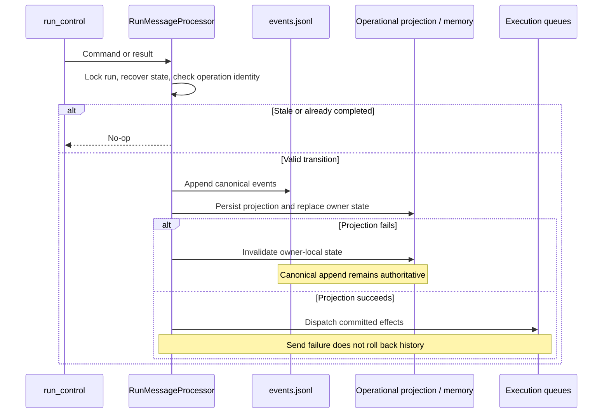
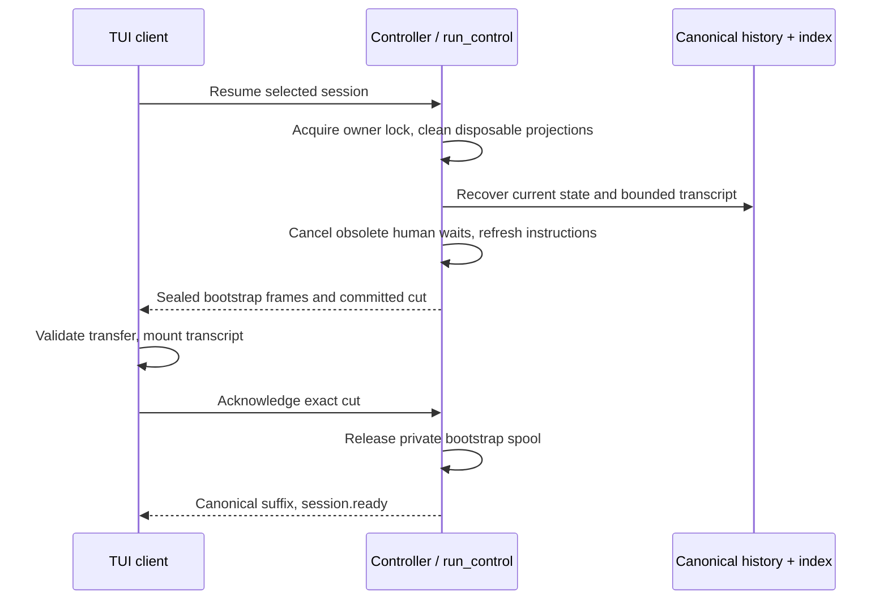

# State and recovery

[Architecture](README.md) · [Session runtime details](session-runtime.md)

## Commit order and authority

`events.jsonl` is canonical. `RunState` is the run-control owner's reconstructed
working state; operational database rows are bounded coordination projections,
not a second conversation store. There is no `state.json` authority.

Transition journals finish interrupted canonical appends and local coordination.
They are not a persistent sending buffer for effects lost after finalization.
After-turn hook failures are logged as local degradation.

## Persistence map

| Store | Purpose / recovery limit |
|---|---|
| Session `events.jsonl` | Conversation, lifecycle and operation identities; canonical replay |
| `sequence.cursor` | Sequence allocation only; holes are valid, not proof of committed tail |
| `history-index.sqlite` | Disposable record locations, turn anchors and previews; rebuildable |
| Application `state.sqlite` | Session catalog, operational projections, pending commands/batches, child/background coordination |
| Session broker database | At-least-once work delivery; separate from application DB |
| Private runtime payload files | Immutable call/result bodies referenced by bounded SQL/transport records |
| Tool-output artifacts | Temporary inspection files; historical notices can outlive them |

`session_id === run_id`; children have distinct identities. Session events cannot
recover SQLite-only pending queues, renames, questions or supervision records.
WAL `synchronous=NORMAL` protects database consistency but can lose recent commits
on machine/power failure; a disposable index rebuild does not restore those commits.

## Resume is owner-led, not a second TUI replay

A failed/cancelled/corrupt bootstrap leaves the TUI visibly unattached. The client
must not enable execution with an empty fallback transcript. Fresh instructions
replace generated context, not conversation messages or compaction summaries.

## Explicit repair

The terminal **`/repair` applies repair and accepts no arguments**. Protocol
clients can request a preview with `apply=false`; there is no `/repair --apply`.
Repair executes through the owning runtime, never directly from the process-mode
TUI's local stores.

Repair preserves current operation identities and refuses unsafe reconstruction.
It can redrive current LLM/shell/tool work, deliver collected sibling results,
settle abandoned deferred child waits, reconcile child lifecycle projections, or
close unmatched terminal tool-call history with synthetic errors. It does not
promise exactly-once effects, erase claimed queue rows or roll back external work.
Check external effects before retrying. Human-input waits are not redispatched;
compaction requires its matching durable prepared request.

Deferred-child repair cancels unfinished children and settles the existing parent
call; it does not launch replacements. Completed children and artifacts remain.
Generation checks prevent a captured repair plan from changing newer work.
A send failure reports partial failure; some effects can already be running.

## Compaction and cancellation

Successful compaction replaces eligible older model context while retaining a raw
tail and canonical history. A failed summary keeps original messages. If the run
is cancelling, cancellation wins; otherwise an interrupted active turn continues,
or a maintenance compaction completes without another model turn.

Cancellation is a request, not rollback. Supported workers observe narrow
operational cancellation state; filesystem writes and remote effects already
completed remain. Escape in a child live view targets that child. Exiting the
TUI instead initiates owned-process shutdown. MCP cancellation remains cooperative.

Sources: [RunCommit](../src/AgentCore/Application/Pipeline/RunCommit.php),
[RunMessageProcessor](../src/AgentCore/Application/Pipeline/RunMessageProcessor.php),
[repair command](../src/Tui/Listener/RepairCommandHandler.php),
[session usage](../docs/session-storage.md), [compaction](../docs/compaction.md).
