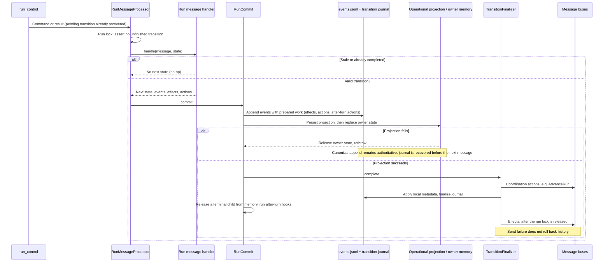
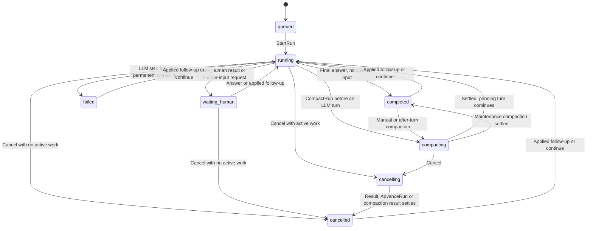
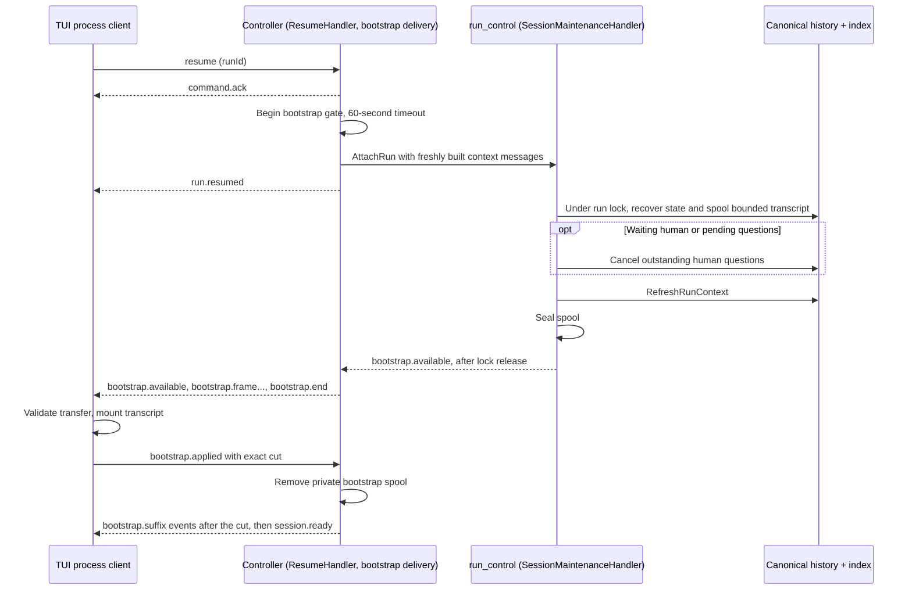

# State and recovery

[Architecture](README.md) · [Session runtime details](session-runtime.md)

## Commit order and authority

`events.jsonl` is canonical. `RunState` is the run-control owner's reconstructed
working state; operational database rows are bounded coordination projections,
not a second conversation store. There is no `state.json` authority.

Events and all follow-up work are appended as one prepared transition. A handler
that returns no new state can still commit effects or actions without events.
Transition journals finish interrupted canonical appends and local coordination:
`PendingTransitionRecovery` replays the finalizer, including its effects, before
ordinary dispatch. They are not a persistent sending buffer for effects lost
after finalization; that requires explicit `/repair`. After-turn hook failures
are logged as local degradation.

## Run status

`RunStatus` lives in `RunState` and is rebuilt from canonical events on replay.

Active work means streaming, a current operation or an unresolved tool call.
Cancel is rejected on `completed` and `failed` runs. A failed compaction settles
the same way as a successful one but keeps the original messages.

## Persistence map

| Store | Purpose / recovery limit |
|---|---|
| Session `events.jsonl` | Conversation, lifecycle and operation identities; canonical replay |
| `sequence.cursor` | Sequence allocation only; holes are valid, not proof of committed tail |
| `history-index.sqlite` | Disposable record locations, turn anchors and previews; rebuildable |
| Application `state.sqlite` | Session catalog, operational projections, pending commands/batches, child/background coordination |
| Session broker database | At-least-once work delivery; separate from application DB |
| Private runtime payload files | Immutable call/result bodies referenced by bounded SQL/transport records |
| Tool-output artifacts | Temporary inspection files; historical notices can outlive them |

`session_id === run_id`; children have distinct identities. Session events cannot
recover SQLite-only pending queues, renames, questions or supervision records.
WAL `synchronous=NORMAL` protects database consistency but can lose recent commits
on machine/power failure; a disposable index rebuild does not restore those commits.

## Resume is owner-led, not a second TUI replay

If the canonical archive grew while `session.ready` waited on the pipe, the
controller streams the extra suffix before finishing; a shrunk archive fails the
attach. Controller startup and shutdown also remove any leftover spool.

A failed/cancelled/corrupt bootstrap leaves the TUI visibly unattached. The client
must not enable execution with an empty fallback transcript. Fresh instructions
replace generated context, not conversation messages or compaction summaries.

## Explicit repair

The terminal **`/repair` applies repair and accepts no arguments**. Protocol
clients can request a preview with `apply=false`; there is no `/repair --apply`.
Repair executes through the owning runtime, never directly from the process-mode
TUI's local stores.

Repair runs through `RepairSession` on `run_control`: it first finishes any
pending transition, checks integrity, then plans repair and applies it unless
the request is a preview. Repair preserves current operation identities and
refuses unsafe reconstruction.
It can redrive current LLM/shell/tool work, deliver collected sibling results,
settle abandoned deferred child waits, reconcile child lifecycle projections, or
close unmatched terminal tool-call history with synthetic errors. It does not
promise exactly-once effects, erase claimed queue rows or roll back external work.
Check external effects before retrying. Human-input waits are not redispatched;
compaction requires its matching durable prepared request.

Deferred-child repair is captured in the verified repair transition as interrupt,
settle or cancel obligations. It cancels unfinished children and settles the
existing parent call; it does not launch replacements. Completed children and
artifacts remain. A parent-turn check prevents a captured repair plan from
changing a newer batch. A send failure reports partial failure; some effects
can already be running.

## Recovery-relevant events

| Canonical `RunEventTypeEnum` | Recovery meaning |
|---|---|
| `run_started`, `turn_advanced`, `history_position_set` | Turn and operation identity; selected history position |
| `llm_step_completed`, `llm_step_failed`, `llm_step_aborted` | Model step outcome; aborted output never enters prompt history |
| `tool_execution_start`, `tool_execution_end`, `tool_call_acknowledged`, `tool_batch_committed` | Batch membership and completion; repair can append synthetic results |
| `waiting_human` | Human wait; not redispatched by repair |
| `agent_command_queued`, `agent_command_applied`, `agent_command_rejected` | Mailbox admission and outcome; events cannot recreate a lost pending row |
| `context_compaction_requested`, `context_compaction_started`, `context_compacted`, `context_compaction_failed` | Prepared compaction request and outcome |
| `context_refreshed`, `history_tail_discarded`, `agent_end` | Context refresh, discarded forward history, terminal reason |

Protocol-only runtime events cover attachment and transport: `runtime.ready`,
`bootstrap.available`, `bootstrap.frame`, `bootstrap.end`, `bootstrap.suffix`,
`session.ready`, `canonical.high_water`, `run.resumed`, `session.restoring`
(process client replaced the controller), `session.repair.completed` and
`protocol.error`.

## Compaction and cancellation

Successful compaction replaces eligible older model context while retaining a raw
tail and canonical history. A failed summary keeps original messages. If the run
is cancelling, cancellation wins; otherwise an interrupted active turn continues,
or a maintenance compaction completes without another model turn.

Cancellation is a request, not rollback. Supported workers observe narrow
operational cancellation state; filesystem writes and remote effects already
completed remain. Escape in a child live view targets that child. Exiting the
TUI instead initiates owned-process shutdown. MCP cancellation remains cooperative.

Sources: [RunCommit](../src/AgentCore/Application/Pipeline/RunCommit.php),
[RunMessageProcessor](../src/AgentCore/Application/Pipeline/RunMessageProcessor.php),
[TransitionFinalizer](../src/AgentCore/Application/Pipeline/TransitionFinalizer.php),
[PendingTransitionRecovery](../src/AgentCore/Application/Pipeline/PendingTransitionRecovery.php),
[RunStatus](../src/AgentCore/Domain/Run/RunStatus.php),
[AdvanceRunHandler](../src/AgentCore/Application/Pipeline/AdvanceRunHandler.php),
[CompactionStepResultHandler](../src/CodingAgent/Application/Pipeline/CompactionStepResultHandler.php),
[ResumeHandler](../src/CodingAgent/Runtime/Controller/CommandHandler/ResumeHandler.php),
[SessionMaintenanceHandler](../src/CodingAgent/Application/Pipeline/SessionMaintenanceHandler.php),
[SessionBootstrapDelivery](../src/CodingAgent/Runtime/Controller/SessionBootstrapDelivery.php),
[RepairDeferredChildrenHandler](../src/CodingAgent/Application/Pipeline/RepairDeferredChildrenHandler.php),
[repair command](../src/Tui/Listener/RepairCommandHandler.php),
[session usage](../docs/session-storage.md), [compaction](../docs/compaction.md).
