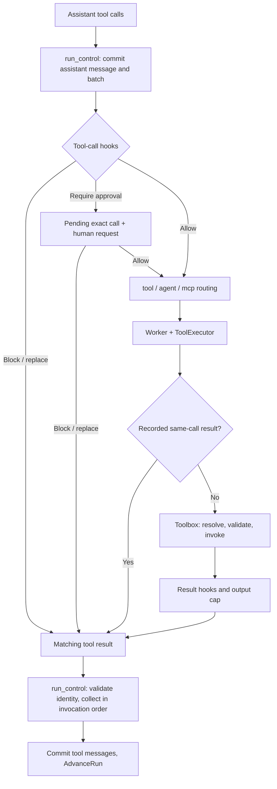
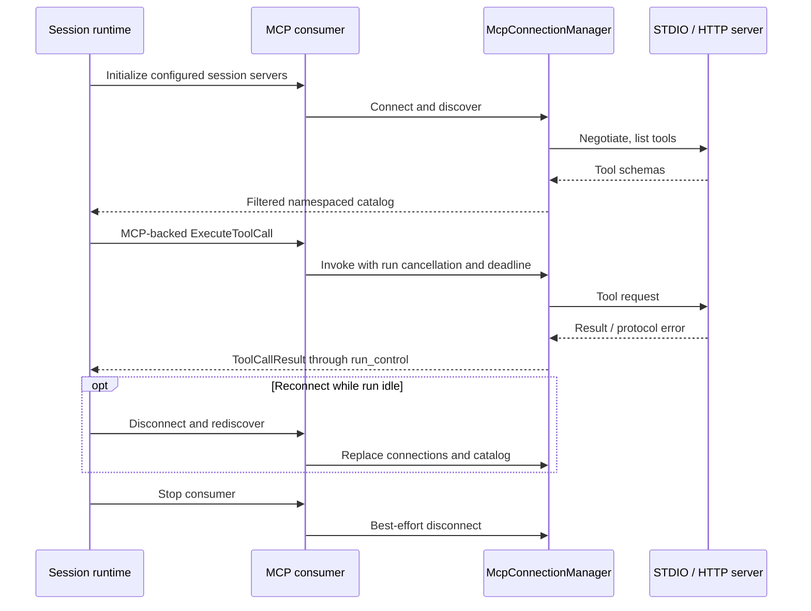

# Tools and MCP

[Architecture](README.md) · [Usage](../docs/tools.md) · [Code mode and scheduling](code-mode-and-scheduling.md)

## Catalog and boundaries

Built-ins provide `ToolDefinitionDTO` through `HatfieldToolProviderInterface`.
Enabled extensions register public `ToolRegistrationDTO`s; connected MCP servers
contribute runtime schemas. `ToolRegistry` and `CodingAgentToolSetResolver` form
the active per-turn toolset after allowlists, exclusions and child policy.
Registration owns execution mode; file mutation tools are sequential.

Typed built-ins expose flat argument DTO fields through Symfony AI argument
resolution and Symfony Validator. Dynamic MCP/extension tools use runtime schemas
and raw argument maps rather than the built-in DTO path. Schemas describe inputs;
they are not authorization rules.

## Execution

Tool-batch admission and worker capacity are separate. `tools.execution.max_parallelism`
bounds a batch; the shared tool worker does not impose a second admission cap.
`subagent` / `agent_resume` route to `agent`; fork stays on `tool`; MCP-backed
calls route to `mcp`. See [processes](processes-and-queues.md).

Stored-result reuse is not concurrent exclusion or exactly-once execution. A
redelivery can repeat an external effect before a result has been recorded.
Handlers with critical effects need their own same-intent idempotency contract.
Deferred outcomes register correlation and settle later instead of returning a
final result immediately.

There is no global executor timeout that rewrites a successful late result.
Bash, PHP scripts and deferred child supervision own their deadlines. Registration
can declare a tool budget; supported handlers check cancellation cooperatively.
Oversized output becomes bounded text plus an inspection-file notice. Artifacts
are transient; replay does not require their continued existence.

## Questions versus approvals

- `ask_human` creates a model question. Its answer settles the waiting call;
  cancellation returns `Cancelled by user`, never implied approval.
- Approval hooks suspend an exact existing call. The originating answer hook
  chooses allow, block or replacement. Allow redispatches that stored call without
  asking the model for an extra decision turn.
- Parent/child questions retain the owning run and request identity. Attaching a
  session cancels obsolete waits; a late answer cannot reopen them.

Public contracts: [question usage](../docs/human-input.md),
[approval policy](../docs/approvals.md),
[extension tool API](../.hatfield/extensions/extension-api/docs/extension-api-tools.md).

## MCP lifecycle

User/project `mcp.json` merge by server name, with whole-entry project replacement.
Server availability and agent selectors constrain the child toolset; see
[MCP configuration](../docs/mcp.md).

Calls use the run cancellation token and the shorter of server `timeoutMs` and
remaining tool budget. Interrupted connected clients can be reused; disconnected
clients are evicted for reconnect. STDIO sends `notifications/cancelled`; HTTP
closes the response body. HTTP protocols through `2025-11-25` also send a
best-effort cancellation POST; `2026-07-28` uses stream closure alone. Blocking
HTTP requests/body reads or that POST delay checks: this is not a hard wall-clock
limit or a guarantee the server stopped/rolled back work.

Worker shutdown attempts graceful disconnect. Unmanaged STDIO grandchildren can
escape cleanup; MCP is a process/network trust boundary, not a sandbox.

Sources: [ToolExecutor](../src/AgentCore/Application/Handler/ToolExecutor.php),
[tool worker](../src/AgentCore/Application/Handler/ExecuteToolCallWorker.php),
[ToolRegistry](../src/CodingAgent/Tool/ToolRegistry.php),
[MCP manager](../src/CodingAgent/Mcp/Client/McpConnectionManager.php),
[Messenger routes](../config/packages/messenger.yaml).
