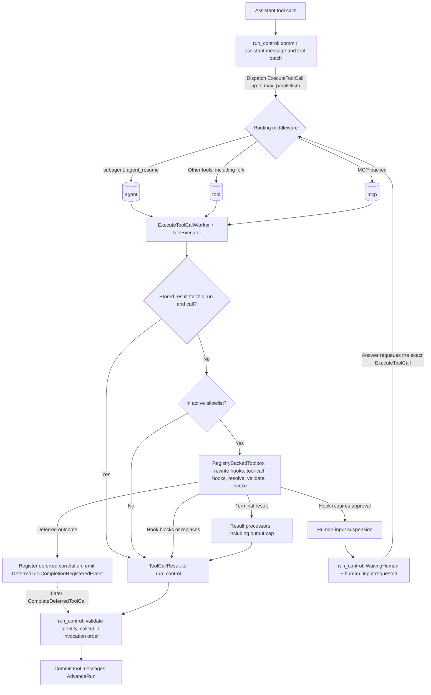
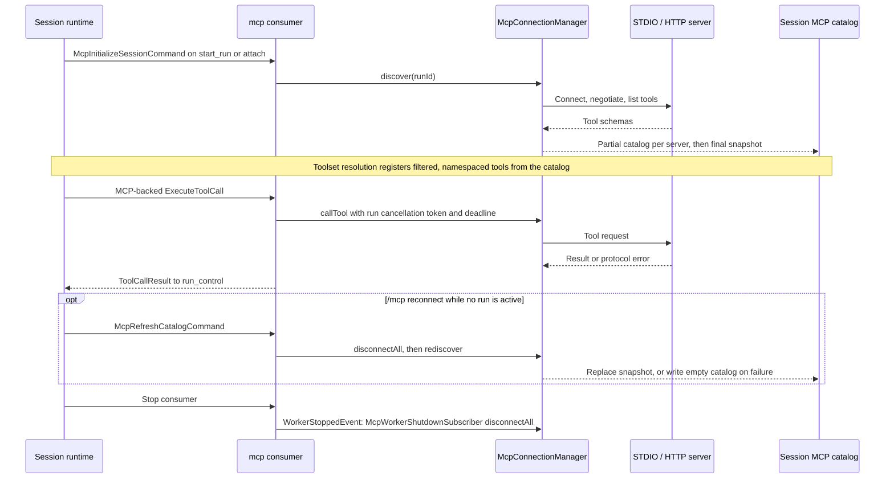

# Tools and MCP

[Architecture](README.md) · [Usage](../docs/tools.md) · [Code mode and scheduling](code-mode-and-scheduling.md)

## Catalog and boundaries

Built-ins provide `ToolDefinitionDTO` through `HatfieldToolProviderInterface`.
Enabled extensions register public `ToolRegistrationDTO`s; connected MCP servers
contribute runtime schemas through the session MCP catalog. `ToolRegistry` and
`CodingAgentToolSetResolver` form the active per-turn toolset after allowlists,
exclusions and child policy. Registration owns execution mode; the default is
sequential, and file mutation tools (`write`, `edit`) declare it explicitly.

Typed built-ins expose flat argument DTO fields through Symfony AI argument
resolution and Symfony Validator. Dynamic MCP/extension tools use runtime schemas
and raw argument maps rather than the built-in DTO path. Schemas describe inputs;
they are not authorization rules.

## Execution

Tool-call hooks run inside the worker, in `RegistryBackedToolbox`, not in
`run_control` before routing.

Tool-batch admission and worker capacity are separate. `tools.execution.max_parallelism`
bounds a batch; the shared tool worker runs with unlimited Fiber concurrency and
does not impose a second admission cap. `SubagentExecuteToolCallRoutingMiddleware`
stamps `subagent` / `agent_resume` for the `agent` transport; fork stays on `tool`.
There is no separate agent consumer: the one shared tool consumer reads `tool`,
`agent` and `code_mode_requests`. `McpExecuteToolCallRoutingMiddleware` stamps
calls whose name is in the session MCP catalog for `mcp`, consumed by a single
`mcp` consumer. See [processes](processes-and-queues.md).

Stored-result reuse is not concurrent exclusion or exactly-once execution. A
redelivery can repeat an external effect before a result has been recorded.
Handlers with critical effects need their own same-intent idempotency contract.
Deferred outcomes register correlation and settle later through
`CompleteDeferredToolCall` instead of returning a final result immediately; result
processors and the post-execution cancellation rewrite skip them.

There is no global executor timeout that rewrites a successful late result.
Bash, PHP scripts and deferred child supervision own their deadlines. Registration
can declare a tool budget; supported handlers check cancellation cooperatively.
Oversized output becomes bounded text plus an inspection-file notice. Artifacts
are transient; replay does not require their continued existence.

## Questions versus approvals

- `ask_human` creates a model question. Its answer settles the waiting call;
  cancellation returns `Cancelled by user`, never implied approval.
- Approval hooks suspend an exact existing call. When the human answers,
  `ApplyCommandHandler` requeues that `ExecuteToolCall` with a typed answer; the
  originating hook's answer handler chooses allow, block or replacement, then the
  remaining hooks run. Allow runs the stored call without an extra model turn.
- Noninteractive contexts (scheduled and other standalone invocations,
  noninteractive child runs) auto-deny approval instead of suspending.
- Parent/child questions retain the owning run and request identity. Attaching a
  session cancels obsolete waits; a late answer cannot reopen them.

Public contracts: [question usage](../docs/human-input.md),
[approval policy](../docs/approvals.md),
[extension tool API](../.hatfield/extensions/extension-api/docs/extension-api-tools.md).

## MCP lifecycle

All MCP connections live in the single `mcp` consumer process; discovery and calls
are serialized there. Other processes see MCP tools only through the session
catalog file.

User/project `mcp.json` merge by server name, with whole-entry project replacement.
Server availability and agent selectors constrain the child toolset; see
[MCP configuration](../docs/mcp.md).

Calls use the run cancellation token and the shorter of server `timeoutMs` and
remaining tool budget. Interrupted connected clients can be reused; disconnected
clients and clients that fail otherwise are evicted for reconnect. Cancellation
itself is implemented in the vendored MCP SDK: STDIO and HTTP protocols through
`2025-11-25` send a best-effort `notifications/cancelled`; `2026-07-28` HTTP
relies on closing the response stream, which happens after every request. Blocking
HTTP requests/body reads or that notification delay checks: this is not a hard
wall-clock limit or a guarantee the server stopped/rolled back work.

Worker shutdown attempts graceful disconnect; it does not run after SIGKILL or an
OOM kill. Unmanaged STDIO grandchildren can escape cleanup; MCP is a
process/network trust boundary, not a sandbox.

Sources: [ToolExecutor](../src/AgentCore/Application/Handler/ToolExecutor.php),
[tool worker](../src/AgentCore/Application/Handler/ExecuteToolCallWorker.php),
[RegistryBackedToolbox](../src/CodingAgent/Tool/RegistryBackedToolbox.php),
[tool hooks](../src/CodingAgent/Extension/ExtensionToolHookEventSubscriber.php),
[ToolRegistry](../src/CodingAgent/Tool/ToolRegistry.php),
[subagent routing](../src/CodingAgent/Agent/Messenger/SubagentExecuteToolCallRoutingMiddleware.php),
[MCP routing](../src/CodingAgent/Mcp/Messenger/McpExecuteToolCallRoutingMiddleware.php),
[MCP lifecycle handler](../src/CodingAgent/Mcp/Handler/McpInitializeSessionHandler.php),
[MCP manager](../src/CodingAgent/Mcp/Client/McpConnectionManager.php),
[MCP shutdown](../src/CodingAgent/Mcp/Messenger/McpWorkerShutdownSubscriber.php),
[Messenger routes](../config/packages/messenger.yaml).
