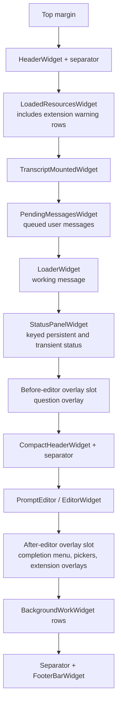
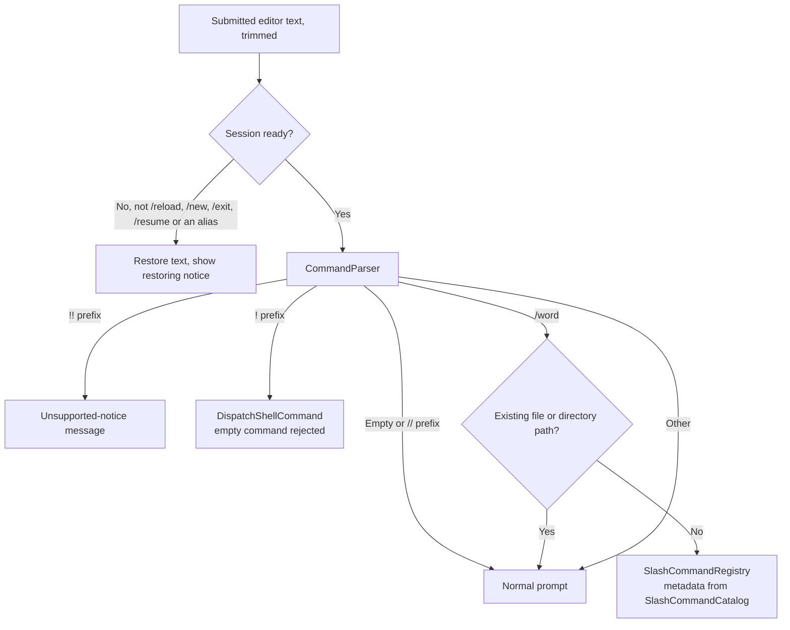
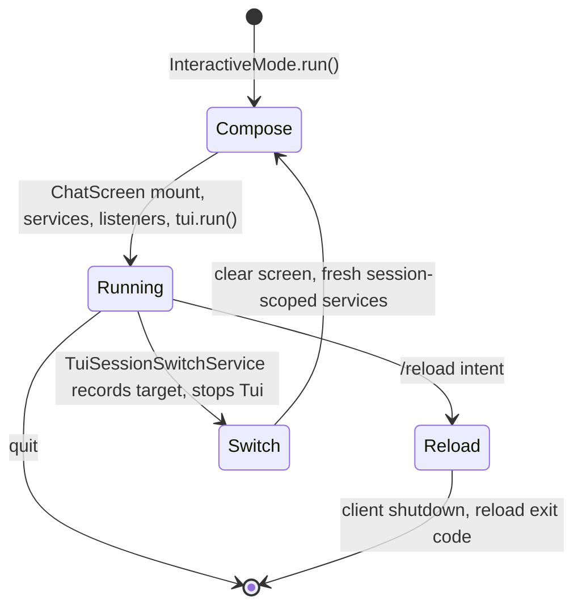

# TUI composition

[Architecture](README.md) · [Projection](context-and-projection.md) · [Terminal usage](../docs/terminal-usage.md)

`InteractiveMode` builds a fresh `Tui`, `ChatScreen` and per-session service scope
(`TuiSessionCompositionFactory`) for each session. `ChatScreen` mounts the widget tree
and owns editor/overlay placement and status entries; session services own commands,
questions, history, polling and projection. Most chrome widgets are project classes
extending Symfony TUI's `AbstractWidget` / `ContainerWidget`; the editor is Symfony's
`EditorWidget` behind the `PromptEditor` facade, and the working indicator is Symfony's
`LoaderWidget`.

## Screen layout

Widgets render in mount order. Overlay slots exist only while an overlay is mounted:
`insertOverlayBeforeEditor()` and `insertOverlayAfterEditor()` remove the tail, add the
overlay and re-add the tail. Completion menus keep editor focus; question overlays and
pickers take focus.

## Input and rendering

Listeners register through `TuiListenerRegistrar` and route `InputEvent`s by
priority (higher first), respecting focus:

| Priority | Role |
|---|---|
| 105 | Completion overlay teardown on interrupt, bracketed paste, copy or forward delete |
| 100 | Global interrupt: Ctrl+C cancel / double-press quit, Ctrl+D quit |
| 98 | Ctrl+O preview expansion |
| 96 | Ctrl+V clipboard image paste and image-path bracketed paste |
| 95 | Ctrl+P model cycling, Shift+Tab reasoning cycling |
| 91 | Ctrl+B backgrounds the running call (`BackgroundBashInputListener`) |
| 90 | Completion routing and Ctrl+\ subagent live view toggle |
| 50 | Extension slot handlers and default-tier listeners (Ctrl+R loaded resources) |

`InputPriority` names these values; the Ctrl+B listener registers at
`COMPLETION_SUBAGENT + 1`.

`//text` is sent as an ordinary prompt; the parser does not strip the slashes.
`SlashCommandCatalog` is process-scoped (metadata, aliases, default handlers,
extension and prompt-template commands); each session binds its own handlers in a
fresh `SlashCommandRegistry`. The catalog registers the built-in commands from
static `BuiltInSlashCommands` data when it is constructed, without building any
service, so their names and aliases are taken before extensions register commands
on `ConsoleEvents::COMMAND` and an extension cannot take them. The built-in
listener registrars only bind per-session handlers. After CLI skill and template
options are applied, `InteractiveMode` runs the dynamic `SlashCommandCatalogRegistrar`
services once, in order: `/code-review`, prompt templates, then `skill:` commands;
each skips names that are already taken. While a subagent live view is active,
`SubagentLiveInputPolicy` allows only `/agents-main`, `/main` and `/agents-live`.

`ImagePasteInputListener` reuses Symfony's `BracketedPasteTrait` buffering on the
focused editor. A sole absolute path to a readable, supported image file is validated,
copied to a private temporary file and inserted as an attachment placeholder; the
source is never owned or deleted. Other pastes are replayed to the editor as native
bracketed paste.

Pickers mount a Symfony `SelectListWidget` and header `TextWidget` in a
`ContainerWidget`. `PickerOverlay` mounts, focuses and closes them; it does not
implement selection rendering. `tui.theme` selects a YAML theme from
`tui.theme_paths` (bundled `config/themes/`, project `.hatfield/themes`,
`~/.hatfield/themes`).

Hatfield uses Symfony's stock renderer and `ScreenWriter`, which wraps each frame in
synchronized output with the cursor hidden and differential writes.
`requestRender(true)` forces a full frame on session switches, live-view entry and
exit, and extension requests.

Tool elapsed labels derive from the canonical `started_at` and terminal
`duration_ms`. Active labels update in whole seconds; terminal labels freeze from
recorded timing. Deferred children retain their own lifecycle timing.

## Session boundary

The TUI sends commands and consumes runtime DTOs through `AgentSessionClient`.
It must not repair or rebuild AgentCore state through local stores. During attach,
execution input stays blocked until the verified bootstrap mount and suffix catch-up
reach `session.ready`. Editor changes made during attach set a dirty flag, and
historical editor prefill does not overwrite them. Automatic recovery of an
already-ready session preserves its current draft.

Parent and selected-child polling have distinct ownership
(`RuntimeEventPoller`, `SubagentLiveChildViewPoller`). While the live view shows a
child, `visibleQuestionOwnerRunId()` targets that child for question display,
Escape and question submission. Leaving the view resets the child projector and releases its transcript.
Session switching stops the old UI loop and constructs fresh session-scoped services.
`/reload` instead shuts the client down and returns a dedicated exit code so the outer
bootstrap rebuilds the kernel.

`InteractiveMode` installs SIGTERM/SIGINT handlers that log `signal_exit` and call
`exit(0)`, so PHP shutdown still runs client cleanup and stops the controller.

## Extension UI

Public `TuiExtensionContextInterface` provides status/transient status, warning
rows, tick hooks, after-editor overlays, focus, text formatting and retained
prompt-row lookup. `BridgeTuiExtensionContext` adapts these contracts; packages do not
import internal `PickerOverlay` or replace the host renderer. Transient notices clear
on the next nonempty submission once the session is ready; persistent status rows
retain their lifetime.

Dependency edges follow [depfile.yaml](../depfile.yaml): TUI can use owning
CodingAgent services directly where allowed. Runtime contracts describe the session
protocol, not wrappers invented to hide permitted CodingAgent dependencies.

Sources: [ChatScreen](../src/Tui/Screen/ChatScreen.php),
[InteractiveMode](../src/Tui/Application/InteractiveMode.php),
[session switch](../src/Tui/Application/TuiSessionSwitchService.php),
[input priorities](../src/Tui/Layout/InputPriority.php),
[command parser](../src/Tui/Command/CommandParser.php),
[submission router](../src/Tui/Command/SubmissionRouter.php),
[submit listener](../src/Tui/Listener/SubmitListener.php),
[image-paste listener](../src/Tui/Listener/ImagePasteInputListener.php),
[picker overlay](../src/Tui/Picker/PickerOverlay.php),
[session state](../src/Tui/Runtime/TuiSessionState.php),
[extension bridge](../src/Tui/Runtime/BridgeTuiExtensionContext.php),
[public TUI API](../.hatfield/extensions/extension-api/docs/extension-api-tui.md).
